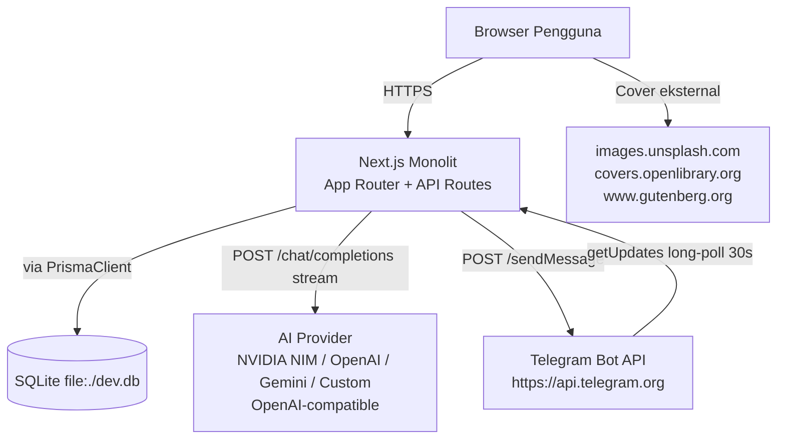
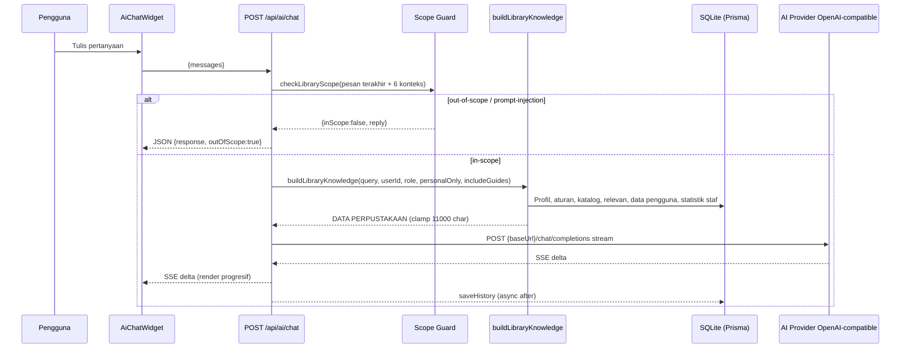
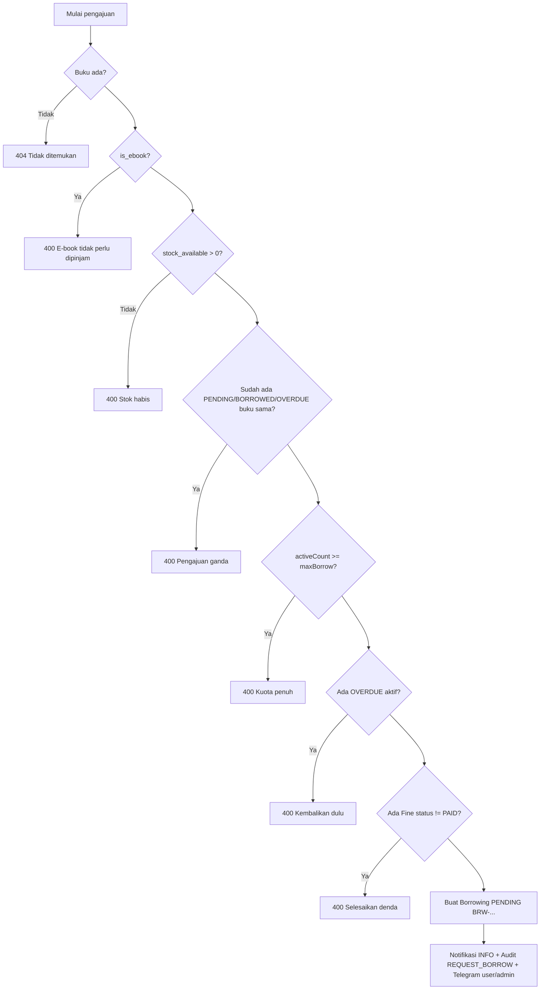
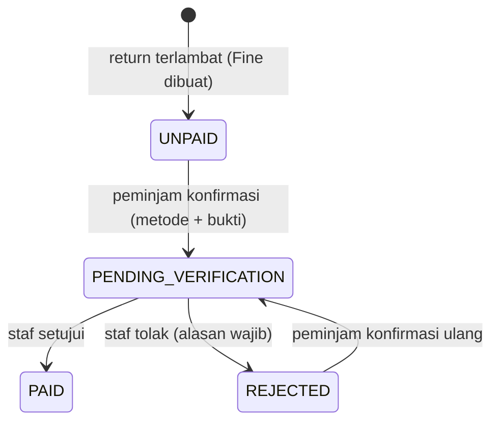
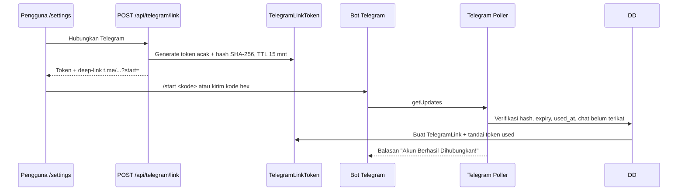

# Product Requirements Document (PRD) — Perpustakaan Digital SMA

## 1. Document Information

| Atribut | Nilai |
|---|---|
| Nama Proyek | Perpustakaan Digital SMA |
| Nama Dokumen | Product Requirements Document (PRD) |
| Versi Dokumen | v2.0 |
| Tanggal Pembuatan | 9 November 2026 |
| Status Dokumen | Final — Refleksi Kondisi Aktual Implementasi |
| Lokasi Dokumen | `docs/PRD_Perpustakaan_Digital_SMA_v2.md` + `docs/PRD_Perpustakaan_Digital_SMA_v2.docx` |
| Lokasi Proyek yang Diaudit | `C:\laragon\www\perpustakaan-digital-sma` |
| NPM Package | `perpustakaan-digital-sma` v0.1.0 |
| Sumber Kebenaran | Source code aktual, `prisma/schema.prisma`, `prisma/seed.ts`, API routes, halaman aplikasi, `package.json`, `next.config.ts`, `.env.example`, `README.md` |
| Dokumen Pembanding | `docs/PRD_ACTUAL_PROJECT.md` (PRD lama — hanya referensi historis, bukan sumber kebenaran utama) |
| Metodologi Audit | Pemeriksaan sistematis: arsitektur, database, role/hak akses, modul/fitur, integrasi AI, integrasi eksternal, UI/UX |
| Riwayat Revisi | v1.0: `PRD_ACTUAL_PROJECT.md`. v2.0: audit ulang menyeluruh; mencerminkan implementasi terbaru termasuk modul denda lengkap |

### 1.1 Tujuan Dokumen Ini

1. Menyediakan single source of truth mengenai **kondisi aktual proyek saat ini** berdasarkan bukti implementasi, bukan asumsi atau dokumentasi lama.
2. Mendokumentasikan seluruh fitur **yang terbukti ada**, fitur yang **parsial**, fitur yang **belum ada**, fitur yang **usang**, dan fitur yang **perlu verifikasi** dengan kategori status yang jelas.
3. Memberikan dasar yang dapat ditelusuri (traceable) untuk pengembangan lanjutan, pengujian penerimaan (acceptance testing), dan operasional.
4. Memisahkan secara eksplisit antara kebutuhan yang **sudah diterapkan** dan kebutuhan yang masih berupa **rekomendasi**.

### 1.2 Prinsip Audit

- PRD lama hanya digunakan sebagai pembanding historis.
- Implementasi proyek saat ini adalah source of truth utama.
- Tidak ada fitur yang diklaim tersedia hanya karena nama file/tombol/halaman. Setiap klaim harus dapat ditelusuri ke file/kode/API/halaman.
- Informasi yang tidak dapat diverifikasi ditandai `NEEDS VERIFICATION`.
- Perbedaan frontend–backend–database didokumentasikan apa adanya.
- Tidak ada credential, password, API key, atau token sensitif yang dimasukkan ke dalam dokumen. Nilai rahasia diganti `***`.

### 1.3 Legenda Kategori Status

| Kategori | Arti |
|---|---|
| `IMPLEMENTED` | Fitur tersedia dan berfungsi berdasarkan bukti implementasi |
| `PARTIALLY IMPLEMENTED` | Fitur tersedia tetapi masih memiliki fungsi yang belum lengkap |
| `NOT IMPLEMENTED` | Fitur belum ditemukan dalam implementasi |
| `OBSOLETE` | Fitur lama sudah tidak digunakan atau telah digantikan |
| `NEEDS VERIFICATION` | Implementasi ditemukan, tetapi fungsinya belum dapat dipastikan tanpa pengujian runtime |

### 1.4 Daftar Isi

1. Document Information
2. Product Overview
3. Product Vision & Objectives
4. Stakeholders & User Roles
5. System Architecture
6. Functional Requirements
7. Role & Permission Matrix
8. Database Requirements
9. AI Requirements
10. External Integration Requirements
11. User Flow & Business Process
12. UI/UX Requirements
13. Non-Functional Requirements
14. System Constraints & Dependencies
15. Current Implementation Status
16. Known Issues & Limitations
17. Future Development & Recommendations
18. Lampiran: Daftar API, Halaman, Variabel Lingkungan, dan Matriks Perbandingan PRD Lama

---

## 2. Product Overview

### 2.1 Latar Belakang

Perpustakaan Sekolah Menengah Atas (SMA) membutuhkan pencatatan sirkulasi yang terpusat, katalog yang dapat dicari, pemisahan hak akses antara admin/pustakawan dan anggota sekolah, serta bantuan pencarian dan rekomendasi berbasis AI. Implementasi saat ini menggunakan monolit Next.js App Router dengan database SQLite lokal dan ORM Prisma, yang mencakup manajemen koleksi buku fisik dan e-book, peminjaman/pengembalian terotorisasi pustakawan, denda keterlambatan dengan alur konfirmasi–verifikasi, manajemen pengguna berbasis role (RBAC), pelaporan sirkulasi, asisten AI perpustakaan (streaming, berbasis data sistem), serta notifikasi Telegram (linking dan pengiriman pesan).

Landing page publik memaparkan layanan dan menampilkan 4 buku contoh dari database. Area terproteksi (dashboard ke atas) memerlukan login.

### 2.2 Deskripsi Produk

Perpustakaan Digital SMA adalah aplikasi web full-stack untuk:

- Katalog buku fisik dan e-book dengan pencarian, filter, dan paginasi.
- Sirkulasi peminjaman yang dikotorisasi pustakawan/admin (ajukan → setujui/tolak → kembalikan).
- Denda keterlambatan otomatis saat pengembalian, dengan alur konfirmasi pembayaran oleh peminjam dan verifikasi oleh pustakawan/admin, termasuk unggahan bukti pembayaran.
- Manajemen pengguna berbasis 5 role (RBAC) dengan kebijakan per role (kuota, durasi, denda) yang dapat diubah admin tanpa redeploy.
- Manajemen koleksi (tambah/edit/nonaktifkan buku dengan inventaris eksemplar otomatis).
- Pelaporan agregat sirkulasi untuk ADMIN/LIBRARIAN.
- AI Assistant sebagai titik tanya berbasis data nyata (bukan pengetahuan umum), tersedia sebagai widget mengambang di semua halaman dashboard.
- Notifikasi in-app (data) dan Telegram (linking token + pengiriman pesan best-effort).
- Dashboard statistik dengan kartu denda dan aksi cepat berbasis role.

### 2.3 Permasalahan yang Diselesaikan

| Masalah | Solusi Aktual |
|---|---|
| Pencatatan peminjaman manual / sirkulasi tidak terpusat | Tabel `borrowings` dengan status `PENDING/BORROWED/RETURNED/OVERDUE/REJECTED`, kode `BRW-YYYYMMDD-XXXX`, audit log |
| Pencarian katalog dan eksemplar tidak terstruktur | Gelombang `GET /api/books` (judul/ISBN/pengarang, filter kategori/format, paginasi 12) + detail eksemplar + filter kategori/author/publisher |
| Tidak adanya RBAC dan kebijakan kuota per role | Enum `Role` 5 nilai, middleware RBAC, `SystemSetting` kuota/durasi/denda per audience student/teacher/staff |
| Informasi status pinjaman/denda tersebar | Dashboard, riwayat `/history`, halaman denda `/fines` + `/fines/[id]`, notifikasi in-app, laporan `/reports` |
| Tidak adanya asistensi AI berbasis data koleksi | AI Assistant streaming (`/api/ai/chat`) dengan konteks `DATA PERPUSTAKAAN` + `DATA PENGGUNA` + `PANDUAN ALUR SISTEM`, scope guard, konfigurasi dinamis |
| Notifikasi aktivitas tidak real-time | Telegram Bot API (linking token, long-polling, pengiriman ke admin global + user terikat) |
| Denda tidak memiliki jalan keluar pembayaran | Modul denda lengkap: konfirmasi (`PENDING_VERIFICATION`) + verifikasi (`PAID/REJECTED`) + bukti file + tenggat pembayaran |

### 2.4 Tujuan Pengembangan (Aktual)

Menyediakan satu sistem web untuk:

1. Katalog dan e-book (daftar, detail, reader PDF, progres baca manual).
2. Peminjaman terotorisasi pustakawan (kuota, blokir overdue/denda, eksemplar otomatis).
3. Denda otomatis saat pengembalian + konfirmasi–verifikasi dengan bukti.
4. Notifikasi in-app + Telegram.
5. AI Assistant berbasis konteks perpustakaan dengan konfigurasi dinamis multi-provider.
6. Pelaporan dasar sirkulasi.

### 2.5 Ruang Lingkup Sistem

**Termasuk dalam ruang lingkup aktual:**

- Public landing, login, dashboard, katalog, detail buku, e-book list dan reader, riwayat peminjaman, rekomendasi popularitas, halaman denda (daftar + detail), AI chat widget, pengaturan profil + Telegram, sirkulasi pustakawan, manajemen koleksi, laporan, manajemen user, system settings, konfigurasi AI dinamis.

**Tidak termasuk / tidak ditemukan:**

- Registrasi mandiri, verifikasi email, reset password via email, pembayaran denda online (gateway), perpanjangan pinjaman, CRUD kategori/author/publisher, upload file e-book biner, export laporan (CSV/PDF/Excel), UI/API pusat notifikasi in-app (baca/tandai dibaca), pembuatan ulasan/rating baru, test suite proyek.

---

## 3. Product Vision & Objectives

### 3.1 Visi Produk

Mendigitalisasi pengelolaan perpustakaan sekolah dengan sirkulasi yang teraudit, katalog yang mudah diakses, denda yang adil dan dapat dibayar secara terverifikasi, serta AI Assistant yang menjawab hanya dari data sistem yang nyata.

### 3.2 Tujuan Utama

1. Satu platform untuk katalog, e-book, sirkulasi, denda, dan laporan.
2. Kebijakan perpustakaan (kuota, durasi, denda per role, tenggat pembayaran denda) dapat diubah admin tanpa redeploy (`SystemSetting`).
3. Konfigurasi AI dapat diubah dari UI admin dan langsung aktif (cache 5 detik, enkripsi API key).
4. Notifikasi Telegram mengurangi ketergantungan pada pengecekan manual aplikasi.

### 3.3 Target yang Ingin Dicapai

| Target | Kondisi Aktual |
|---|---|
| Seluruh modul inti dapat diakses lewat satu aplikasi Next.js | Terpenuhi — monolit Next.js 16 App Router |
| Kebijakan `SystemSetting` dapat diubah tanpa redeploy | Terpenuhi — 10 kunci seed + kunci AI dinamis |
| Konfigurasi AI dapat diubah dari UI dan langsung aktif | Terpenuhi — `saveAiConfig` transaksi + cache 5 detik |
| Denda dapat dilunasi secara terverifikasi | Terpenuhi (v2) — konfirmasi + verifikasi + bukti + histori status |
| Notifikasi Telegram ke admin dan user | Terpenuhi — best-effort, tetap tidak membatalkan transaksi bila gagal |

### 3.4 Indikator Keberhasilan

Tidak ada dashboard KPI otomatis selain laporan sirkulasi (`GET /api/reports`). Indikator yang dapat diukur dari data sistem:

| Dimensi | Indikator |
|---|---|
| Adopsi | Jumlah user `ACTIVE` per role; login per minggu (memerlukan logging) |
| Sirkulasi | `BORROWED`, `OVERDUE`, rata-rata waktu return, rasio `RETURNED/(BORROWED+RETURNED)` |
| Keterlambatan | Jumlah dan nilai total denda, belum bayar, menunggu verifikasi, lunas |
| Katalog | Jumlah `Book`, e-book, halaman katalog per pengguna |
| AI | Jumlah chat per pengguna, tingkat diterima vs `outOfScope`, latensi upstream (hasil uji koneksi) |
| Telegram | Persentase user terhubung, tingkat deliveri (`ok` vs `Upstream error`) |
| Kepuasan | Rating rata-rata (`rating_avg`, `reviews` read-only); tidak ada KPI NPS |
| Kualitas | Jumlah temuan Known Issues yang ditutup per siklus |

---

## 4. Stakeholders & User Roles

### 4.1 Daftar Aktor

| Aktor | Deskripsi |
|---|---|
| `ADMIN` | Administrator sistem — mengelola user, kebijakan perpustakaan, konfigurasi AI, serta proses sirkulasi |
| `LIBRARIAN` | Pustakawan — memproses peminjaman/pengembalian, mengelola koleksi, memverifikasi denda, melihat laporan |
| `STUDENT` | Peserta didik — mencari buku, mengajukan pinjam, membaca e-book, memantau status/denda, bertanya ke AI |
| `TEACHER` | Guru/tenaga pengajar — sama dengan STUDENT dengan kuota/durasi/denda berbeda |
| `STAFF` | Staff sekolah — sama dengan STUDENT dengan kuota/durasi/denda berbeda |
| *Publik* | Pengunjung belum login — hanya landing + login |

### 4.2 Deskripsi, Hak Akses, dan Batasan per Role

| Role | Menu yang Dapat Diakses | Aktivitas | Batasan |
|---|---|---|---|
| `ADMIN` | Semua menu termasuk `/admin/users`, `/admin/system-settings`, `/admin/system-settings?tab=ai`, `/reports`, `/librarian/*`, `/fines` | Kelola user, ubah settings, konfigurasi AI, proses sirkulasi, kelola koleksi, verifikasi denda | Tidak dapat menonaktifkan akun sendiri |
| `LIBRARIAN` | `/dashboard`, `/catalog`, `/ebook`, `/history`, `/fines`, `/recommendations`, `/librarian/borrowings`, `/librarian/books`, `/reports`, `/settings`, AI chat | Setujui/tolak/kembalikan, tambah/edit/nonaktifkan buku, verifikasi denda | Tidak mengakses `/admin/*` |
| `STUDENT` | `/dashboard`, `/catalog`, `/ebook`, `/history`, `/fines`, `/recommendations`, `/settings`, AI chat | Ajukan pinjam, batalkan `PENDING`, baca e-book, ubah profil/password, hubungkan Telegram, konfirmasi pembayaran denda milik sendiri | Tidak mengakses `/librarian/*`, `/admin/*`, `/reports`; tidak dapat konfirmasi denda orang lain; tidak dapat verifikasi denda |
| `TEACHER` | Sama dengan STUDENT | Sama, dengan kuota/durasi/denda berbeda | Sama |
| `STAFF` | Sama dengan STUDENT | Sama, dengan kuota/durasi/denda berbeda | Sama |
| *Publik* | `/`, `/login` (+ `/register` diartikan sebagai halaman auth oleh middleware, tetapi tidak ada halaman register) | Lihat landing + 4 buku contoh, login | Tidak dapat mengakses `/dashboard`, `/catalog`, dan semua halaman terproteksi |

**Bukti implementasi:**

- Sidebar role filter: `src/components/layout/Sidebar.tsx:32-66` (5 role untuk menu umum; `LIBRARIAN,ADMIN` untuk operasional termasuk Verifikasi Denda; `ADMIN` untuk administrasi).
- Middleware RBAC: `src/middleware.ts:8-48` (`/admin` hanya ADMIN; `/librarian` hanya LIBRARIAN/ADMIN; `/fines` terproteksi untuk semua role login; halaman terproteksi dialihkan ke `/login` dengan `callbackUrl`).
- API menegakkan otorisasi server-side (contoh: `src/app/api/borrowings/[id]/route.ts:20`, `src/app/api/reports/route.ts:8`, `src/app/api/admin/users/route.ts:20`, `src/app/api/fines/[id]/verify/route.ts:19`, `src/app/api/fines/[id]/confirm/route.ts:33-36`).
- `UserStatus`: `ACTIVE | SUSPENDED`. Akun `SUSPENDED` tidak dapat login (`src/lib/auth.ts:44-46`).
- Default role baru: `STUDENT` (`prisma/schema.prisma:60`). Seed menyediakan 5 akun demo (password seed `Password123!`, lihat `prisma/seed.ts:34-93`).
  - **PERINGATAN KEAMANAN:** Akun demo dengan password `Password123!` hanya untuk development/testing. Akun demo bukan akun produksi, tidak boleh digunakan untuk penggunaan nyata, dan seluruh password harus diganti sebelum sistem digunakan secara operasional.

### 4.3 Tanggung Jawab Utama

| Role | Tanggung Jawab |
|---|---|
| ADMIN | Manajemen user dan RBAC; mengubah `SystemSetting` (kuota/durasi/denda/tenggat denda); konfigurasi AI dinamis (provider/base URL/model/API key); uji koneksi AI; proses sirkulasi; kelola koleksi; verifikasi pembayaran denda |
| LIBRARIAN | Memproses pengajuan (setujui/tolak), pengembalian (hitung denda otomatis), verifikasi pembayaran denda (setujui/tolak dengan alasan), menambah/mengedit/menonaktifkan buku, melihat laporan sirkulasi |
| STUDENT/TEACHER/STAFF | Mengajukan dan membatalkan pengajuan `PENDING`, membaca e-book dan menyimpan progres, mengonfirmasi pembayaran denda milik sendiri dengan metode + bukti opsional, mengelola profil/password dan tautan Telegram |
| Publik | Melihat landing page dan sampel katalog; menuju login |

---

## 5. System Architecture

### 5.1 Teknologi yang Digunakan (Terbukti)

| Komponen | Teknologi | Bukti |
|---|---|---|
| Framework | Next.js 16.3.3 (App Router) | `package.json:21` |
| UI | React 19.2.8, Tailwind CSS 4, lucide-react | `package.json:23-25,32,37` |
| Bahasa | TypeScript 5 | `package.json:39` |
| Database | SQLite (`file:./dev.db`) via Prisma 6 | `prisma/schema.prisma:1-4`, `.env.example:1` |
| Auth | NextAuth.js v4 (Credentials, JWT, 24 jam) | `src/lib/auth.ts:7-86` |
| Validasi | Zod 4 | `package.json:26` |
| Password hash | bcryptjs (cost 12 untuk user baru) | `src/app/api/admin/users/route.ts:109`, `src/app/api/auth/change-password/route.ts:37` |
| AI provider awal | NVIDIA NIM (`integrate.api.nvidia.com/v1`) via `.env.example:4-5`; runtime dinamis multi-provider | `src/lib/ai-config.ts` |
| Notifikasi | Telegram Bot API (fetch, long-polling) | `src/lib/telegram.ts`, `src/lib/telegram-poller.ts` |

### 5.2 Arsitektur Aplikasi

Monolit Next.js: halaman (Server/Client Components) + Route Handlers API di `src/app/api/` + library bisnis di `src/lib/` + Prisma Client singleton (`src/lib/db.ts`). Tidak ada backend terpisah.

**Struktur relevan:**

```text
src/app/            → landing, (auth)/login, (dashboard)/*, api/*/*
src/components/     → ui/, layout/, ai/, borrow/, fines/, admin/, providers/
src/lib/            → auth.ts, borrowing.ts, fine.ts, telegram.ts, telegram-poller.ts,
                      ai-config.ts, ai-knowledge.ts, ai-scope.ts, ai-workflows.ts,
                      db.ts, utils.ts
src/middleware.ts   → proteksi & RBAC
src/instrumentation.ts → auto-start Telegram poller (Node runtime)
prisma/             → schema.prisma, seed.ts, dev.db
public/ebooks/      → 2 file PDF sampel lokal
public/uploads/payment-proofs/ → bukti pembayaran denda (dibuat saat runtime)
scripts/            → telegram-poll.ts, test-ai-config.ts, test-ai-chat-live.ts
```

### 5.3 Frontend

| Area | Lokasi | Fungsi |
|---|---|---|
| Publik | `src/app/page.tsx` | Landing, daftar 4 buku, statistik role, link login |
| Auth | `src/app/(auth)/login/page.tsx` | Input `Email / NISN / NIP` + password, toggle lihat password, `signIn("credentials")` |
| Dashboard | `src/app/(dashboard)/dashboard/page.tsx` | Statistik DB, kuota role dari `SystemSetting`, kartu denda sendiri, panel Manajemen Denda untuk staf (4 kartu + badge menunggu verifikasi), aksi cepat role-based |
| Katalog | `src/app/(dashboard)/catalog/page.tsx` | Pencarian judul/ISBN/pengarang, filter kategori/format, paginasi 12, badge E-Book, overlay Tidak Tersedia |
| Detail buku | `src/app/(dashboard)/books/[id]/page.tsx` | Metadata, inventaris eksemplar (Server Component membaca DB langsung), 5 ulasan terakhir, tombol pinjam via `BorrowAction`, link baca/unduh e-book |
| E-book list | `src/app/(dashboard)/ebook/page.tsx` | Daftar e-book (`is_ebook=true`), pencarian, paginasi 12 |
| E-book reader | `src/app/(dashboard)/ebook/[id]/page.tsx` | PDF iframe (`#page=N&zoom=Z`), zoom 50–200%, fullscreen, panel progres manual, unduh/tab baru |
| Riwayat | `src/app/(dashboard)/history/page.tsx` | Tabel pinjaman milik sendiri + batalkan `PENDING` (ikon X), info denda + link detail denda, status badge |
| Denda daftar | `src/app/(dashboard)/fines/page.tsx` | Kartu ringkasan 4 status, filter status, tabel paginasi 20, indikator sisa/lewat tenggat, link detail. Staf melihat semua denda; anggota hanya miliknya |
| Denda detail | `src/app/(dashboard)/fines/[id]/page.tsx` | Kartu total/batas/keterlambatan, info peminjaman, konfirmasi pembayaran (form metode + bukti + catatan), verifikasi (setujui/tolak + alasan), timeline riwayat status |
| Rekomendasi | `src/app/(dashboard)/recommendations/page.tsx` | Grid 12 buku `GET /api/books?limit=12&sort=popular` + tombol refresh; label "berdasarkan popularitas dan rating" |
| AI Assistant | Widget mengambang `src/components/ai/AiChatWidget.tsx` (dipakai di `src/app/(dashboard)/layout.tsx`); route `/ai-assistant` hanya redirect ke `/dashboard` | Chat SSE streaming, saran awal, hapus tampilan percakapan, Escape untuk tutup |
| Pustakawan | `/librarian/borrowings`, `/librarian/books` | Proses peminjaman (filter status, approve/reject/return) dan manajemen buku (modal tambah/edit/nonaktifkan) |
| Admin | `/admin/users`, `/admin/system-settings` (tab AI via `AiConfigSettings`) | Manajemen user (modal, toggle Aktif/Suspend) dan system settings (simpan per baris) |
| Laporan | `/reports` | 6 kartu statistik, panel Buku Terpopuler, Peminjaman Terbaru; redirect non-staf ke `/dashboard` |
| Pengaturan | `/settings` | Profil (nama/email, role read-only), ubah password, integrasi Telegram (hubungkan/salin token/deep-link/putuskan, polling status tiap 3 detik) |

### 5.4 Backend

Route Handlers di `src/app/api/` (lihat Lampiran A). Semua endpoint pinjaman/admin/denda memeriksa `getServerSession(authOptions)`. Daftar buku dan `/api/categories|authors|publishers` publik di level API (tanpa sesi), tetapi UI-nya berada di area terproteksi. Daftar denda/filter dibatasi server: staf melihat semua, anggota hanya miliknya.

### 5.5 Database

SQLite via Prisma. Detail di Bagian 8.

### 5.6 Alur Komunikasi Antarkomponen



- `src/instrumentation.ts` memulai Telegram poller saat server Node start (`NEXT_RUNTIME === "nodejs"`), single-consumer via `globalThis.__telegramPollerStarted`.
- AI runtime config dibaca dari `SystemSetting` (enkripsi AES-256-GCM) dengan fallback env; cache 5 detik.
- Knowledge AI dibangun dari agregat DB (profil koleksi, aturan, katalog, data pengguna, statistik staf) dengan cache umum 5 menit + cache per-user 30 detik.

### 5.7 Integrasi Eksternal

1. **Telegram Bot API** — pengiriman `sendMessage`, `getUpdates` long-polling (30 dtk), linking berbasis token hash.
2. **AI Provider (OpenAI-compatible)** — `POST {baseUrl}/chat/completions` (stream SSE) dan `GET {baseUrl}/models`; preset NVIDIA/OpenAI/Gemini/Custom.
3. **Cover eksternal** — `images.unsplash.com`, `covers.openlibrary.org`, `www.gutenberg.org` (`next.config.ts:5-18`).

---

## 6. Functional Requirements

Daftar kebutuhan fungsional berdasarkan modul, dengan ID konsisten. Format: `FR-<DOMAIN>-NNN`. Kolom Status menggunakan kategori di Bagian 1.3.

### 6.1 Autentikasi & Otorisasi (AUTH)

| ID | Kebutuhan | Status | Bukti/Lokasi |
|---|---|---|---|
| FR-AUTH-001 | Login dengan `Email / NISN / NIP` + password (NextAuth Credentials, JWT 24 jam) | IMPLEMENTED | `src/lib/auth.ts:7-63`, `src/app/api/auth/[...nextauth]/route.ts:4-6`, UI `login/page.tsx:25-41` |
| FR-AUTH-002 | Akun `SUSPENDED` tidak dapat login | IMPLEMENTED | `src/lib/auth.ts:44-46` |
| FR-AUTH-003 | Proteksi halaman via middleware + redirect `/login` dengan `callbackUrl` | IMPLEMENTED | `src/middleware.ts:4-33` |
| FR-AUTH-004 | RBAC route `/admin` (ADMIN) dan `/librarian` (LIBRARIAN/ADMIN) | IMPLEMENTED | `src/middleware.ts:36-48` |
| FR-AUTH-005 | Ubah nama/email profil sendiri (role tidak dapat diubah) | IMPLEMENTED | `src/app/api/auth/profile/route.ts:12-42`, `settings/page.tsx:141-163` |
| FR-AUTH-006 | Ubah password dengan verifikasi password saat ini (min. 8 karakter) | IMPLEMENTED | `src/app/api/auth/change-password/route.ts:13-43` |
| FR-AUTH-007 | Registrasi mandiri | NOT IMPLEMENTED | Belum ditemukan dalam audit menyertakan halaman/API register (middleware hanya meneruskan `/register` sebagai auth page) |
| FR-AUTH-008 | Verifikasi email / reset password via email | NOT IMPLEMENTED | Belum ditemukan dalam audit |
| FR-AUTH-009 | Logout | IMPLEMENTED | Via NextAuth session (`signOut` tersedia di Navbar; tidak ada API logout khusus) |

**Detail FR-AUTH-001 s.d. FR-AUTH-006:**

- **Deskripsi:** Sistem menyediakan login credentials dengan identifier Email **atau** NISN/NIP, password ter-hash bcrypt, sesi JWT 24 jam (token memuat `id, role, nisn_nip, class_or_dept`), proteksi halaman via middleware, RBAC route, serta manajemen profil/password mandiri.
- **Aktor:** Semua role terdaftar; Publik untuk login.
- **Precondition:** Akun `ACTIVE` terdaftar; `NEXTAUTH_SECRET` dikonfigurasi.
- **Main flow:** Buka `/` → `Masuk Sistem` → `/login` → isi identifier + password → `signIn("credentials")` → sukses: redirect `callbackUrl` (default `/dashboard`); `SUSPENDED`: error.
- **Alternative flow:** Token ada saat membuka `/login`/`/register` → redirect `/dashboard`. Token tidak ada saat membuka halaman terproteksi → redirect `/login?callbackUrl=<pathname>`. Role tidak sesuai `/admin` atau `/librarian` → redirect `/dashboard?error=UnauthorizedAccess`.
- **Input:** `identifier` (email/nissn_nip), `password`; profil: `name` min. 2, `email` valid; password: `currentPassword`, `newPassword` min. 8.
- **Output:** Sesi JWT; dashboard berbasis role; pesan sukses/error dalam Bahasa Indonesia.
- **Business rules:** Identifikasi akun dengan `OR: [email lowercase, nisn_nip]`; `SUSPENDED` selalu ditolak; role tidak dapat diubah dari profil; email baru harus unik (409 bila duplikat).
- **Validasi:** Zod di semua POST/PUT kritis; password lama diverifikasi dengan bcrypt sebelum ubah; hash baru cost 12.
- **Status implementasi:** IMPLEMENTED (kecuali FR-AUTH-007/008 NOT IMPLEMENTED).

### 6.2 Pengguna & Admin (USER / ADMIN)

| ID | Kebutuhan | Status | Bukti/Lokasi |
|---|---|---|---|
| FR-USER-001 | Admin membuat user (nama min 2, email valid-unik, password min 8, role, NISN/NIP, kelas) | IMPLEMENTED | `src/app/api/admin/users/route.ts:89-148` |
| FR-USER-002 | Admin mengedit user + reset password opsional | IMPLEMENTED | `src/app/api/admin/users/[id]/route.ts:41-89` |
| FR-USER-003 | Admin menonaktifkan user (soft-delete `SUSPENDED`), tidak dapat menonaktifkan diri sendiri | IMPLEMENTED | `src/app/api/admin/users/[id]/route.ts:92-122` |
| FR-USER-004 | Daftar, cari, filter role/status, paginasi user | IMPLEMENTED | `src/app/api/admin/users/route.ts:18-87`, UI `admin/users/page.tsx` |
| FR-USER-005 | Toggle cepat Aktif/Suspend dari tabel (field `is_active`) | IMPLEMENTED | `src/app/api/admin/users/[id]/route.ts:8-17,63-65`, UI `admin/users/page.tsx:196-203` |
| FR-ADMIN-001 | Admin mengubah `SystemSetting` yang sudah ada (key+value) per baris; pengecualian `fine_payment_deadline_days` boleh dibuat bila belum ada | IMPLEMENTED | `src/app/api/admin/settings/route.ts:26-50`, UI `admin/system-settings/page.tsx:62-85` |
| FR-ADMIN-002 | Admin melihat/mengubah konfigurasi AI dinamis (provider, base URL, model, API key) | IMPLEMENTED | `src/app/api/admin/ai-config/route.ts`, `src/lib/ai-config.ts:317-411` |
| FR-ADMIN-003 | Admin menguji koneksi AI dan memuat daftar model dinamis | IMPLEMENTED | `src/app/api/admin/ai-config/test/route.ts`, `models/route.ts`, `src/lib/ai-config.ts:450-645` |
| FR-ADMIN-004 | Riwayat perubahan konfigurasi AI (maks 10) | IMPLEMENTED | `src/app/api/admin/ai-config/route.ts:32-57`, `AiConfigSettings.tsx:676-726` |
| FR-ADMIN-005 | Admin mengubah tenggat pembayaran denda (`fine_payment_deadline_days`, default 7 hari) | IMPLEMENTED | `src/lib/fine.ts:4-19`, `prisma/seed.ts:22`, `admin/settings/route.ts:38-50` |

**Detail penting USER/ADMIN:**

- Membuat user: email duplikat → 409; NISN/NIP kosong otomatis `AUTO-<timestamp>`; password di-hash bcrypt cost 12; audit log `CREATE USER`; notifikasi Telegram `USER_CREATED` best-effort.
- Edit user: nama/email/role/NISN-NIP/kelas opsional; password baru opsional min. 8; audit log `UPDATE USER`.
- Nonaktifkan: mengubah status menjadi `SUSPENDED` (tidak hapus data); menonaktifkan diri sendiri → 400. UI: modal konfirmasi + tombol nonaktif dinonaktifkan untuk diri sendiri.
- System settings: hanya kunci yang sudah ada yang dapat diubah, kecuali `fine_payment_deadline_days`; key lain yang tidak ada → 404.
- Pengaturan ditampilkan sebagai kartu per kunci dengan tombol Simpan per baris; `fine_per_day_*` menampilkan padanan Rupiah; `fine_payment_deadline_days` menampilkan label hari.

### 6.3 Katalog & Buku (BOOK)

| ID | Kebutuhan | Status | Bukti/Lokasi |
|---|---|---|---|
| FR-BOOK-001 | Daftar buku + pencarian (judul/ISBN/pengarang), filter kategori/e-book/author, paginasi | IMPLEMENTED | `src/app/api/books/route.ts:4-48` |
| FR-BOOK-002 | Detail buku + eksemplar + 5–10 ulasan terakhir + rating rata-rata | IMPLEMENTED | `src/app/api/books/[id]/route.ts:4-34`, `books/[id]/page.tsx:8-39` |
| FR-BOOK-003 | Daftar kategori/author/publisher untuk filter dan form | IMPLEMENTED (read-only) | `src/app/api/categories/route.ts`, `authors/route.ts`, `publishers/route.ts` |
| FR-BOOK-004 | Pustakawan/admin menambah buku (ISBN unik, validasi tahun 1900–2100) + auto-create eksemplar `BC-XXXX-001...` | IMPLEMENTED | `src/app/api/librarian/books/route.ts:25-91` |
| FR-BOOK-005 | Pustakawan/admin mengedit buku (ISBN/stok tidak diubah dari API update) | IMPLEMENTED | `src/app/api/librarian/books/[id]/route.ts:23-69` |
| FR-BOOK-006 | Pustakawan/admin menonaktifkan buku (eksemplar → `MAINTENANCE`, ditolak bila pinjaman `PENDING/BORROWED` aktif) | IMPLEMENTED | `src/app/api/librarian/books/[id]/route.ts:72-110` |
| FR-BOOK-007 | CRUD kategori/author/publisher | NOT IMPLEMENTED | Belum ditemukan dalam audit; hanya `GET` list |
| FR-BOOK-008 | Upload file e-book (biner) | NOT IMPLEMENTED | Hanya URL string (`ebook_file_url`); tidak ada layanan upload — lihat Bagian 12 |
| FR-BOOK-009 | Membuat ulasan/rating baru | NOT IMPLEMENTED | Model `Review` ada, tetapi tidak ditemukan API `POST /api/reviews`; detail hanya membaca review |
| FR-BOOK-010 | Halaman publik menampilkan 4 buku contoh (tanpa login) | IMPLEMENTED | `src/app/page.tsx:17-20,136-166` |

**Detail BOOK:**

- **Input daftar:** `page` default 1, `limit` default 12, `search` (judul/ISBN/nama pengarang via `contains`), `category` (kode kategori), `author` (author_id), `is_ebook` (`true`/`false`). Output: `data` buku dengan relasi kategori/author/publisher + `_count.copies`, `meta` paginasi. Urutan selalu `createdAt desc` (lihat FR-REC-002).
- **Tambah buku:** `title` min. 2, `isbn` min. 5 unik (409 bila duplikat), `author_id/publisher_id/category_id` wajib, `publish_year` 1900–2100, `stock_total` int min. 0 default 1, `stock_available = stock_total`, default rak `Rak Umum`, format e-book default `PDF`. Eksemplar dibuat `BC-<4 digit terakhir ISBN>-NNN` dengan status `AVAILABLE`, kondisi `Baik`. Audit log `CREATE BOOK`.
- **Edit buku:** field skalar + relasi (`author/publisher/category` via `connect`); ISBN dan stok tidak dapat diubah dari API update (tidak ada di schema update). Audit log `UPDATE BOOK`.
- **Nonaktifkan:** ditolak bila ada `PENDING/BORROWED` (400); bila lolos, semua eksemplar → `MAINTENANCE` (tidak hapus data buku). Audit log `DELETE BOOK`.
- **Known inconsistency:** Form UI (`librarian/books/page.tsx`) menyertakan field `language` dan `pages` yang tidak ada di model `Book` dan tidak ada di schema API create/update. Field tersebut dikirim ke API tetapi diabaikan Zod (bukan di schema create/update) — lihat Bagian 16.

### 6.4 Peminjaman & Pengembalian (TRANSACTION / BORROWING)

| ID | Kebutuhan | Status | Bukti/Lokasi |
|---|---|---|---|
| FR-TRANSACTION-001 | Pengajuan pinjam buku fisik (status `PENDING`, kode `BRW-YYYYMMDD-XXXX`) | IMPLEMENTED | `src/app/api/borrowings/route.ts:80-212`, `src/lib/borrowing.ts:69-76` |
| FR-TRANSACTION-002 | Menolak pengajuan e-book | IMPLEMENTED | `src/app/api/borrowings/route.ts:97-99` |
| FR-TRANSACTION-003 | Menolak pengajuan bila stok `stock_available <= 0` | IMPLEMENTED | `src/app/api/borrowings/route.ts:101-103` |
| FR-TRANSACTION-004 | Menolak pengajuan ganda (buku sama, status `PENDING/BORROWED/OVERDUE`) | IMPLEMENTED | `src/app/api/borrowings/route.ts:105-119` |
| FR-TRANSACTION-005 | Menegakkan kuota aktif per role (`max_borrow_*`) | IMPLEMENTED | `src/app/api/borrowings/route.ts:121-131`, `src/lib/borrowing.ts:25-49` |
| FR-TRANSACTION-006 | Memblokir pengajuan bila ada `OVERDUE` aktif atau denda `UNPAID` (`status not PAID`) | IMPLEMENTED | `src/app/api/borrowings/route.ts:133-155` |
| FR-TRANSACTION-007 | Batalkan pengajuan `PENDING` (pemilik atau pustakawan/admin; status → `REJECTED` + catatan `[Dibatalkan]`, bukan hapus) | IMPLEMENTED | `src/app/api/borrowings/[id]/route.ts:265-309`, `history/page.tsx:88-107` |
| FR-TRANSACTION-008 | Setujui pinjaman (`PENDING→BORROWED`): pilih eksemplar `AVAILABLE`, kurangi `stock_available`, naikkan `total_borrowed`, set `due_date` sesuai kebijakan role peminjam | IMPLEMENTED | `src/app/api/borrowings/[id]/route.ts:42-116` |
| FR-TRANSACTION-009 | Tolak pinjaman (`PENDING→REJECTED`) | IMPLEMENTED | `src/app/api/borrowings/[id]/route.ts:117-155` |
| FR-TRANSACTION-010 | Kembalikan buku (`BORROWED/OVERDUE→RETURNED`), hitung denda `ceil(lateDays) × fine_per_day`, buat `Fine` bila perlu, kembalikan eksemplar/stok | IMPLEMENTED | `src/app/api/borrowings/[id]/route.ts:156-242`, `src/lib/borrowing.ts:57-67` |
| FR-TRANSACTION-011 | Sinkronisasi overdue otomatis saat pustakawan memuat daftar (idempoten) + notifikasi in-app | IMPLEMENTED | `src/app/api/borrowings/route.ts:14-34,50-52` (tidak ada cron terjadwal) |
| FR-TRANSACTION-012 | Perpanjangan pinjaman | NOT IMPLEMENTED | Belum ditemukan dalam audit (due date hanya dihitung saat approve) |
| FR-TRANSACTION-013 | Riwayat pinjaman sendiri + detail buku | IMPLEMENTED | `src/app/api/borrowings/route.ts:36-78`, `history/page.tsx` |
| FR-TRANSACTION-014 | Pengembalian mandiri oleh peminjam dari `/history` | NOT IMPLEMENTED (by design) | UI hanya menyediakan batal `PENDING` dan link Detail; pengembalian diproses pustakawan di `/librarian/borrowings` |

**Detail peminjaman:**

- **Kebijakan role** (`src/lib/borrowing.ts`): `STUDENT 3 buku / 7 hari / Rp2.000`, `TEACHER 7/14/1000`, `STAFF 5/10/1000`, `LIBRARIAN/ADMIN 7/14/1000` (fallback). Suffix mapping hanya student/teacher/staff; LIBRARIAN/ADMIN memakai suffix student dengan fallback TEACHER. Konfigurasi diambil dari `SystemSetting` dengan fallback default bila kunci tidak ada atau tidak valid.
- **Pengajuan:** `book_id` wajib, `notes` maks. 500. Pengecekan urut: buku ada → bukan e-book → stok > 0 → tidak ganda → kuota belum penuh → tidak ada `OVERDUE`/`UNPAID`. Sukses: dibuat `PENDING`, notifikasi `INFO`, audit `REQUEST_BORROW`, Telegram ke user + admin (best-effort).
- **Approve:** hanya `PENDING` + stok > 0 + ada eksemplar `AVAILABLE` terurut `copy_code`. Transaksi atomik: `BORROWED`, `borrow_date=now`, `due_date=now+durasi role peminjam`, `approved_by`, `book_copy_id`, `stock_available-1`, `total_borrowed+1`, eksemplar `BORROWED`. Notifikasi `BORROW_APPROVED`, audit `APPROVE_BORROW`, Telegram `BORROW_APPROVED`.
- **Reject:** hanya `PENDING` → `REJECTED`. Notifikasi `BORROW_REJECTED`, audit `REJECT_BORROW`, Telegram `BORROW_REJECTED`.
- **Return:** hanya `BORROWED/OVERDUE` → `lateDays = ceil((now-due)/hari)`, `fine = lateDays × fine_per_day role peminjam`, `fineDueAt = now + tenggat denda`, `RETURNED`, `return_date=now`, `fine_amount`, `is_fine_paid=(fine==0)`; naikkan `stock_available`; eksemplar → `AVAILABLE`; upsert `Fine UNPAID` (kode `DN-YYYYMMDD-XXXX`, snapshot `late_days/fine_per_day/due_at`) bila denda > 0. Notifikasi `INFO`, audit `RETURN_BOOK`, Telegram `BOOK_RETURNED`.
- **Batal:** owner atau staf, hanya `PENDING` → `REJECTED` + `[Dibatalkan]` pada notes; audit `CANCEL_BORROW`; tidak ada Telegram/notifikasi in-app khusus.
- **Overdue sync:** saat staf memuat `GET /api/borrowings`, `BORROWED` dengan `due_date < now` diubah massal menjadi `OVERDUE` + `OVERDUE_ALERT` per peminjam. Tidak ada `DUE_REMINDER` yang dikirim dan tidak ada cron.

### 6.5 Denda (FINE) — Modul Baru pada v2

| ID | Kebutuhan | Status | Bukti/Lokasi |
|---|---|---|---|
| FR-FINE-001 | Daftar denda + filter status + paginasi + ringkasan agregat | IMPLEMENTED | `src/app/api/fines/route.ts:9-72`, `fines/page.tsx` |
| FR-FINE-002 | Detail denda + timeline riwayat perubahan status | IMPLEMENTED | `src/app/api/fines/[id]/route.ts:7-49`, `fines/[id]/page.tsx` |
| FR-FINE-003 | Peminjam mengonfirmasi pembayaran (metode wajib, catatan opsional, bukti opsional) → `PENDING_VERIFICATION` | IMPLEMENTED | `src/app/api/fines/[id]/confirm/route.ts:23-150` |
| FR-FINE-004 | Unggahan bukti pembayaran (JPG/PNG/WebP/PDF, maks. 2 MB) ke `public/uploads/payment-proofs` | IMPLEMENTED | `src/app/api/fines/[id]/confirm/route.ts:10-16,78-95` |
| FR-FINE-005 | Staf memverifikasi konfirmasi (setujui → `PAID`, tolak → `REJECTED` + alasan wajib) | IMPLEMENTED | `src/app/api/fines/[id]/verify/route.ts:13-123` |
| FR-FINE-006 | Unduh/tampil bukti pembayaran secara terproteksi (owner atau staf) | IMPLEMENTED | `src/app/api/fines/[id]/proof/route.ts:16-55`, `src/lib/fine.ts:137` |
| FR-FINE-007 | Perhitungan tenggat pembayaran, sisa hari, status lewat tenggat / segera jatuh tempo | IMPLEMENTED | `src/lib/fine.ts:4-36,92-143` |
| FR-FINE-008 | Pencatatan histori status denda (`FineStatusHistory`) + audit log + notifikasi in-app | IMPLEMENTED | `confirm/route.ts:114-142`, `verify/route.ts:85-115` |
| FR-FINE-009 | Tenggat pembayaran denda dapat diatur admin (`fine_payment_deadline_days`, default 7) | IMPLEMENTED | `src/lib/fine.ts:4-19`, `prisma/seed.ts:22` |
| FR-FINE-010 | Pembayaran denda online via gateway | NOT IMPLEMENTED | Tidak ditemukan; pembayaran dilakukan offline (tunai/transfer/QRIS manual) lalu dikonfirmasi |

**Detail alur denda:**

1. Denda dibuat saat pengembalian terlambat (`status UNPAID`, `fine_code DN-...`, `amount`, `reason "Terlambat N hari (RpX/hari)"`, snapshot `late_days/fine_per_day`, `due_at = return_date + tenggat`).
2. Peminjam membuka `/fines` → Detail (`/fines/[id]`) → isi **Metode pembayaran** (wajib, maks. 100 karakter), **Catatan** (opsional, maks. 1000), **Bukti** (opsional: JPG/PNG/WebP/PDF, maks. 2 MB; nama disimpan maks. 255 karakter) → `POST /api/fines/[id]/confirm` (multipart/form-data). Status menjadi `PENDING_VERIFICATION`, `confirmed_at=now`, `paid_at` dikosongkan.
3. Staf membuka `/fines?status=PENDING_VERIFICATION` (dari Sidebar Verifikasi Denda atau Dashboard) → Detail → melihat bukti (gambar inline atau link PDF) → **Setujui (Lunas)** atau **Tolak** (alasan wajib, maks. 1000) → `POST /api/fines/[id]/verify`.
   - Approve: `PAID`, `paid_at=now`, `verified_by/at` diisi; `Borrowing.is_fine_paid=true`, `fine_amount=amount`.
   - Reject: `REJECTED`, `rejection_reason` diisi, `verified_by/at` diisi; peminjam dapat mengonfirmasi ulang.
4. Setiap transisi mencatat `FineStatusHistory` (`from_status`, `to_status`, `actor_id/name`, `reason`), `AuditLog` (`CONFIRM_FINE_PAYMENT`, `VERIFY_FINE_PAID`, `VERIFY_FINE_REJECTED`), dan notifikasi `INFO` ke pemilik.
5. Daftar menampilkan kartu ringkasan: Total, Belum Dibayar, Menunggu Verifikasi, Sudah Lunas (jumlah tagihan + nominal). Filter: Semua, Belum Dibayar, Menunggu Verifikasi, Lunas, Ditolak.
6. Detail menampilkan: Total Denda, Batas Pembayaran (`due_at`), Keterlambatan (`late_days × fine_per_day` + reason), info peminjaman (buku, peminjam, tanggal pinjam/jatuh tempo/kembali), blok konfirmasi/verifikasi, dan timeline histori.
7. `due_at` untuk denda lama tanpa snapshot dihitung `createdAt + tenggat`; `late_days/fine_per_day` lama diurai dari `reason` via regex `Terlambat N hari (RpX/hari)` atau dihitung dari `due_date/return_date`; bila masih kosong, diambil dari kebijakan role peminjam.

### 6.6 E-Book (EBOOK)

| ID | Kebutuhan | Status | Bukti/Lokasi |
|---|---|---|---|
| FR-EBOOK-001 | Daftar e-book + pencarian + paginasi (`is_ebook=true`) | IMPLEMENTED | `ebook/page.tsx:29-56`, `GET /api/books?is_ebook=true` |
| FR-EBOOK-002 | Reader PDF (iframe, zoom 50–200%, fullscreen) + unduh/tab baru | IMPLEMENTED (PDF) | `ebook/[id]/page.tsx:138-311` |
| FR-EBOOK-003 | Simpan progres baca manual (`last_page`, `total_pages`, upsert) | IMPLEMENTED | `src/app/api/ebooks/[id]/progress/route.ts:48-90`, UI `ebook/[id]/page.tsx:89-116,314-386` |
| FR-EBOOK-004 | Pratinjau format non-PDF | NOT IMPLEMENTED | Ditegaskan di UI: "tidak bisa pratinjau langsung" (`ebook/[id]/page.tsx:277-303`) |
| FR-EBOOK-005 | Progres otomatis dari halaman PDF | NOT IMPLEMENTED | Belum ditemukan dalam audit; progres dimasukkan manual |
| FR-EBOOK-006 | Validasi e-book (harus `is_ebook=true`) | IMPLEMENTED | `ebooks/[id]/progress/route.ts:37-39,60-63` |

- **Input progres:** `last_page` ≥ 1, `total_pages` ≥ 1, `last_page` dibatasi `total_pages`. Output: record `EbookProgress` (upsert `user_id+book_id`, `last_read_at=now`). UI menampilkan persen `last_page/total_pages`, tombol Simpan dan Selesai (`last_page=total_pages`).

### 6.7 Rekomendasi (RECOMMENDATION)

| ID | Kebutuhan | Status | Bukti/Lokasi |
|---|---|---|---|
| FR-REC-001 | Halaman rekomendasi + tombol refresh | IMPLEMENTED (non-generatif) | `recommendations/page.tsx:24-41`, label "berdasarkan popularitas dan rating" |
| FR-REC-002 | Sort popular dari backend (`?sort=popular`) | PARTIALLY IMPLEMENTED | Frontend mengirim `sort=popular`, tetapi `GET /api/books` (`src/app/api/books/route.ts`) mengabaikan parameter `sort` dan selalu `orderBy createdAt`. Hasil rekomendasi = buku terbaru, bukan terpopuler |
| FR-REC-003 | Rekomendasi AI generatif personal di halaman ini | NOT IMPLEMENTED | AI Assistant terpisah; panduan AI menegaskan "Halaman Rekomendasi memakai data popularitas, bukan AI generatif" (`src/lib/ai-workflows.ts:41`) |

### 6.8 AI Assistant (AI)

| ID | Kebutuhan | Status | Bukti/Lokasi |
|---|---|---|---|
| FR-AI-001 | Chat streaming SSE (`/api/ai/chat`, max history 20, model history 10) | IMPLEMENTED | `src/app/api/ai/chat/route.ts:166-412`, widget `AiChatWidget.tsx:73-213` |
| FR-AI-002 | Konteks perpustakaan (profil koleksi, aturan, katalog 15 buku, buku relevan ≤8, data pengguna, statistik staf) dengan cache | IMPLEMENTED | `src/lib/ai-knowledge.ts` (`buildLibraryKnowledge`, cache 5 menit + per-user 30 detik) |
| FR-AI-003 | Batasan topik (scope guard: small-talk, prompt-injection, off-topic) | IMPLEMENTED | `src/lib/ai-scope.ts`, `src/app/api/ai/chat/route.ts:217-231` |
| FR-AI-004 | Panduan alur aplikasi + data pengguna sebagai sumber tunggal; anti-halusinasi judul | IMPLEMENTED | `src/lib/ai-workflows.ts`, `SYSTEM_PROMPT` di `route.ts:28-120` |
| FR-AI-005 | Riwayat chat per user (GET 50, simpan async via `after()`) | IMPLEMENTED | `src/app/api/ai/chat/route.ts:414-438,160-164` |
| FR-AI-006 | Widget chat mengambang di semua halaman dashboard | IMPLEMENTED | `src/app/(dashboard)/layout.tsx:34`, `AiChatWidget.tsx` |
| FR-AI-007 | Route halaman `/ai-assistant` | PARTIALLY IMPLEMENTED | Hanya redirect ke `/dashboard` (`ai-assistant/page.tsx:9-10`) |
| FR-AI-008 | Enkripsi API key AI (AES-256-GCM) + masking + SSRF guard + cache runtime 5 detik | IMPLEMENTED | `src/lib/ai-config.ts:113-204,212-290,416-444` |
| FR-AI-009 | Konfigurasi AI dinamis multi-provider (NVIDIA/OpenAI/Gemini/Custom) | IMPLEMENTED | `src/lib/ai-config.ts`, `src/app/api/admin/ai-config/*` |
| FR-AI-010 | Uji koneksi AI dan muat daftar model dinamis | IMPLEMENTED | `src/lib/ai-config.ts:450-645` |

Lihat Bagian 9 untuk rincian arsitektur AI.

### 6.9 Notifikasi & Telegram (NOTIFICATION / TELEGRAM)

| ID | Kebutuhan | Status | Bukti/Lokasi |
|---|---|---|---|
| FR-NOTIF-001 | Notifikasi in-app dibuat saat pengajuan, persetujuan, penolakan, pengembalian, overdue, konfirmasi/verifikasi denda | IMPLEMENTED (data) | `src/app/api/borrowings/route.ts:171-180`, `[id]/route.ts:86-94,127-135,209-220`, `fines/*/route.ts`, enum `NotificationType` di `schema.prisma:43-50` |
| FR-NOTIF-002 | UI/API pusat notifikasi (daftar, tandai dibaca) | NOT IMPLEMENTED | Belum ditemukan dalam audit; tidak ada halaman/API notifikasi; AI hanya membaca `is_read=false` |
| FR-TELEGRAM-001 | Hubungkan akun Telegram (token acak 15 menit, hash SHA-256, deep-link `t.me/...?start=`) | IMPLEMENTED | `src/lib/telegram.ts:290-315,449-492`, `src/app/api/telegram/link/route.ts:24-69`, UI `settings/page.tsx:81-111` |
| FR-TELEGRAM-002 | Polling getUpdates (long-poll 30 dtk, single-consumer, auto-start via instrumentation) | IMPLEMENTED | `src/lib/telegram-poller.ts:17-119`, `src/instrumentation.ts:1-6`, `scripts/telegram-poll.ts` |
| FR-TELEGRAM-003 | Notifikasi Telegram: pengajuan baru (admin), disetujui/ditolak/dikembalikan (user), user baru (admin) | IMPLEMENTED (best-effort) | `src/lib/telegram.ts:90-284,494-551`, `README.md:42-113` |
| FR-TELEGRAM-004 | Putuskan hubungan Telegram | IMPLEMENTED | `src/app/api/telegram/unlink/route.ts:6-21` |

### 6.10 Laporan (REPORT)

| ID | Kebutuhan | Status | Bukti/Lokasi |
|---|---|---|---|
| FR-REPORT-001 | Laporan agregat (total buku/e-book/user, aktif, terlambat, total denda borrowing, belum bayar, menunggu verifikasi, ditolak, total lunas denda, terbaru, terpopuler) | IMPLEMENTED | `src/app/api/reports/route.ts:6-72` |
| FR-REPORT-002 | Halaman laporan (ADMIN/LIBRARIAN) | IMPLEMENTED | `src/app/(dashboard)/reports/page.tsx` |
| FR-REPORT-003 | Export laporan (CSV/PDF/Excel) | NOT IMPLEMENTED | Belum ditemukan dalam audit |

- Laporan menampilkan 6 kartu (Total Buku, E-Book, Total Pengguna, Peminjaman Aktif, Terlambat, Total Denda) + panel Buku Terpopuler (top 10 by `total_borrowed desc`) + Peminjaman Terbaru (10 terbaru). Frontend memakai 6 metrik; API menyediakan hingga 12 metrik (termasuk `pendingFines`, `rejectedFines`, `paidFinesTotal`, `unpaidFines` count).

### 6.11 Audit & Sistem (AUDIT / SYSTEM)

| ID | Kebutuhan | Status | Bukti/Lokasi |
|---|---|---|---|
| FR-AUDIT-001 | Audit log untuk pinjaman, user, buku, denda, dan konfigurasi AI | IMPLEMENTED | `src/app/api/borrowings/*`, `admin/users/*`, `librarian/books/*`, `fines/*`, `src/lib/ai-config.ts:388-407` |
| FR-AUDIT-002 | UI audit log global (di luar riwayat AI) | NOT IMPLEMENTED | Belum ditemukan dalam audit; riwayat AI hanya di `AiConfigSettings`, histori denda di detail denda |
| FR-SYSTEM-001 | Dashboard menampilkan statistik, kebijakan role, denda belum bayar, panel Manajemen Denda staf, aksi cepat | IMPLEMENTED | `src/app/(dashboard)/dashboard/page.tsx:24-298` |

---

## 7. Role & Permission Matrix

Berdasarkan implementasi aktual (middleware + sidebar + API server-side). `✓` = diizinkan; `—` = tidak diizinkan.

### 7.1 Matriks Akses Halaman

| Halaman | Publik | Semua Role Login | LIBRARIAN+ADMIN | ADMIN |
|---|---|---|---|---|
| `/`, `/login` | ✓ | — | — | — |
| `/dashboard` | — | ✓ | ✓ | ✓ |
| `/catalog` | — | ✓ | ✓ | ✓ |
| `/books/[id]` (via `/catalog`, `/history`, `/librarian/borrowings`, `/ebook`) | — | ✓ | ✓ | ✓ |
| `/ebook`, `/ebook/[id]` | — | ✓ | ✓ | ✓ |
| `/history` | — | ✓ | ✓ | ✓ |
| `/fines`, `/fines/[id]` | — | ✓ (staf: semua; anggota: milik sendiri) | ✓ (semua) | ✓ (semua) |
| `/recommendations` | — | ✓ | ✓ | ✓ |
| `/settings` (profil/password/Telegram milik sendiri) | — | ✓ | ✓ | ✓ |
| `/librarian/borrowings`, `/librarian/books` | — | — | ✓ | ✓ |
| `/reports` | — | — | ✓ | ✓ |
| `/admin/users`, `/admin/system-settings`, `/admin/system-settings?tab=ai` | — | — | — | ✓ |
| `/ai-assistant` | — | Redirect ke `/dashboard` untuk semua | — | — |

### 7.2 Matriks Akses API dan Operasi CRUD

| Operasi | Publik | Member (STUDENT/TEACHER/STAFF) | LIBRARIAN | ADMIN |
|---|---|---|---|---|
| `GET /api/books`, `GET /api/books/[id]`, `GET /api/categories`, `GET /api/authors`, `GET /api/publishers` | ✓ (level API, tanpa sesi) | ✓ | ✓ | ✓ |
| `GET /api/borrowings` | — | ✓ (hanya miliknya) | ✓ (semua + sync overdue) | ✓ (semua + sync overdue) |
| `POST /api/borrowings` (ajukan) | — | ✓ | ✓ (sebagai peminjam) | ✓ (sebagai peminjam) |
| `PUT /api/borrowings/[id]` (approve/reject/return) | — | — | ✓ | ✓ |
| `DELETE /api/borrowings/[id]` (batal `PENDING`) | — | ✓ (miliknya) | ✓ (semua) | ✓ (semua) |
| `GET /api/fines` | — | ✓ (miliknya) | ✓ (semua) | ✓ (semua) |
| `GET /api/fines/[id]` | — | ✓ (miliknya) | ✓ (semua) | ✓ (semua) |
| `POST /api/fines/[id]/confirm` | — | ✓ (miliknya) | — (403) | — (403) |
| `POST /api/fines/[id]/verify` | — | — | ✓ | ✓ |
| `GET /api/fines/[id]/proof` | — | ✓ (miliknya) | ✓ (semua) | ✓ (semua) |
| `GET/PUT /api/ebooks/[id]/progress` | — | ✓ (progres sendiri) | ✓ | ✓ |
| `GET/POST /api/ai/chat` | — | ✓ | ✓ | ✓ |
| `GET /api/reports` | — | — | ✓ | ✓ |
| `GET/POST /api/admin/users`, `GET/PUT/DELETE /api/admin/users/[id]` | — | — | — | ✓ |
| `GET/POST /api/admin/settings` | — | — | — | ✓ |
| `GET/POST /api/admin/ai-config`, `POST /api/admin/ai-config/models`, `POST /api/admin/ai-config/test` | — | — | — | ✓ |
| `GET/POST /api/telegram/link`, `DELETE /api/telegram/unlink` | — | ✓ (miliknya) | ✓ (miliknya) | ✓ (miliknya) |
| `PUT /api/auth/profile`, `POST /api/auth/change-password` | — | ✓ (miliknya) | ✓ (miliknya) | ✓ (miliknya) |
| `POST /api/librarian/books`, `PUT/DELETE /api/librarian/books/[id]` | — | — | ✓ | ✓ |

### 7.3 Catatan Pemisahan Hak Akses

- Dashboard bersifat personalisasi, bukan pemisahan halaman terpisah: staf melihat total global (peminjaman aktif global, agregat denda semua pengguna), anggota melihat miliknya (peminjaman aktif milik sendiri, tunggakan milik sendiri). Kuota di dashboard dibedakan per role (`max_borrow_teacher/staff/student`). Aksi cepat ditampilkan berbasis role (sirkulasi untuk staf, admin untuk ADMIN).
- API `GET /api/fines` dan `GET /api/borrowings` menegakkan batasan data di server (staf vs anggota), bukan hanya menyembunyikan UI.
- Verifikasi denda (`/verify`) hanya ADMIN/LIBRARIAN; konfirmasi (`/confirm`) hanya non-staf pemilik.
- Tidak ada hak akses yang dibuat berdasarkan asumsi. Seluruh matriks di atas dapat ditelusuri ke middleware, sidebar, dan masing-masing Route Handler.

---

## 8. Database Requirements

Sumber: `prisma/schema.prisma` (374 baris), `prisma/seed.ts`. Database aktual: SQLite file `prisma/dev.db` via `DATABASE_URL=file:./dev.db`.

### 8.1 Ringkasan Entitas (16 Model)

| Model | Tabel | Keterangan |
|---|---|---|
| `User` | `users` | Akun dengan `nisn_nip` + `email` unik, role, status |
| `Category` | `categories` | `code` unik |
| `Author` | `authors` | Penulis |
| `Publisher` | `publishers` | Penerbit |
| `Book` | `books` | Judul buku; `isbn` unik; relasi wajib author/publisher/category |
| `BookCopy` | `book_copies` | Eksemplar; `copy_code` unik; cascade dari `Book` |
| `Borrowing` | `borrowings` | Transaksi pinjam; `borrow_code` unik |
| `Fine` | `fines` | Denda per peminjaman; `borrowing_id` unik; `fine_code` unik opsional |
| `FineStatusHistory` | `fine_status_histories` | Timeline perubahan status denda (baru pada v2) |
| `EbookProgress` | `ebook_progress` | Progres baca per user per buku; unik pasangan |
| `Review` | `reviews` | Ulasan (read-only; tidak ada API tulis) |
| `Notification` | `notifications` | Notifikasi in-app (tulis saja; tidak ada UI/API baca) |
| `AuditLog` | `audit_logs` | Jejak audit aksi |
| `AiChatHistory` | `ai_chat_histories` | Riwayat chat AI per user |
| `SystemSetting` | `system_settings` | Kebijakan dan konfigurasi AI; `key` unik |
| `TelegramLink` | `telegram_links` | Tautan Telegram per user; `user_id` dan `telegram_chat_id` unik |
| `TelegramLinkToken` | `telegram_link_tokens` | Token linking sekali pakai; `user_id` dan `token_hash` unik |

### 8.2 Enum

| Enum | Nilai |
|---|---|
| `Role` | `ADMIN`, `LIBRARIAN`, `STUDENT`, `TEACHER`, `STAFF` (default `STUDENT`) |
| `UserStatus` | `ACTIVE`, `SUSPENDED` (default `ACTIVE`) |
| `CopyStatus` | `AVAILABLE`, `BORROWED`, `MAINTENANCE`, `LOST` (default `AVAILABLE`) |
| `BorrowStatus` | `PENDING`, `BORROWED`, `RETURNED`, `OVERDUE`, `REJECTED` (default `PENDING`) |
| `FineStatus` | `UNPAID`, `PENDING_VERIFICATION`, `PAID`, `REJECTED` (default `UNPAID`) |
| `NotificationType` | `INFO`, `DUE_REMINDER`, `OVERDUE_ALERT`, `BORROW_APPROVED`, `BORROW_REJECTED`, `SYSTEM` (default `INFO`) |

### 8.3 Struktur Data Penting per Entitas

**User:** `id` (UUID), `nisn_nip` unique, `name`, `email` unique, `password_hash` (bcrypt), `role`, `class_or_dept?`, `status`, `createdAt`, `updatedAt`. Index: `role`, `status`. Relasi: `borrowings` (UserBorrowings), `approvedLoans` (LibrarianApprovals), `reviews`, `ebookProgress`, `notifications`, `aiChats`, `auditLogs`, `telegramLink?`, `verifiedFines` (FineVerifier), `fineHistories` (FineHistoryActor).

**Category:** `id`, `code` unique, `name`, `description?`. Index `name`. Relasi `books`.

**Author:** `id`, `name`, `bio?`, `books`, `createdAt`. Index `name`.

**Publisher:** `id`, `name`, `address?`, `phone?`, `email?`, `books`, `createdAt`. Index `name`.

**Book:** `id`, `isbn` unique, `title`, `publish_year` Int, `author_id`, `publisher_id`, `category_id` (semua wajib), `stock_total` default 1, `stock_available` default 1, `location_rack` default `Rak Umum`, `cover_image?`, `description?`, `is_ebook` default false, `ebook_file_url?`, `ebook_format?` default `PDF`, `ebook_size_mb?`, `tags?`, `total_borrowed` default 0, `rating_avg` default 0, `createdAt`, `updatedAt`. Index: `title`, `category_id`, `author_id`, `publisher_id`, `is_ebook`. Relasi: `copies`, `borrowings`, `reviews`, `ebookProgress`.

**BookCopy:** `id`, `copy_code` unique, `book_id` (cascade), `status` default `AVAILABLE`, `condition` default `Baik`, timestamps. Index `book_id`, `status`. Relasi `borrowings`.

**Borrowing:** `id`, `borrow_code` unique, `user_id` (cascade), `book_id` (cascade), `book_copy_id?` (SetNull), `request_date` default now, `borrow_date?`, `due_date?`, `return_date?`, `status` default `PENDING`, `approved_by?`, `fine_amount` default 0, `is_fine_paid` default false, `notes?`, timestamps. Index `user_id`, `book_id`, `status`, `due_date`. Relasi `fine?`.

**Fine:** `id`, `fine_code?` unique, `borrowing_id` unique (cascade), `amount`, `reason`, `status` default `UNPAID`, `late_days` default 0, `fine_per_day` default 0, `due_at?`, `paid_at?`, `confirmed_at?`, `payment_method?`, `payment_note?`, `proof_url?`, `proof_name?`, `rejection_reason?`, `verified_by_id?` (SetNull), `verified_at?`, `createdAt`, `updatedAt`. Index `status`. Relasi `histories`.

**FineStatusHistory:** `id`, `fine_id` (cascade), `from_status?`, `to_status`, `actor_id?` (SetNull), `actor_name?`, `reason?`, `createdAt`. Index `fine_id`.

**EbookProgress:** `id`, `user_id` (cascade), `book_id` (cascade), `last_page` default 1, `total_pages` default 1, `last_read_at` default now. Unik `@@unique([user_id, book_id])`.

**Review:** `id`, `user_id` (cascade), `book_id` (cascade), `rating` Int, `comment`, `createdAt`. Index `book_id`, `user_id`.

**Notification:** `id`, `user_id` (cascade), `title`, `message`, `is_read` default false, `type` default `INFO`, `createdAt`. Index `user_id`, `is_read`.

**AuditLog:** `id`, `user_id?` (SetNull), `action`, `entity`, `entity_id?`, `details?`, `ip_address?`, `createdAt`. Index `action`, `entity`, `createdAt`.

**AiChatHistory:** `id`, `user_id` (cascade), `prompt`, `response`, `createdAt`. Index `user_id`.

**SystemSetting:** `id`, `key` unique, `value`, `description?`, `updatedAt`.

**TelegramLink:** `id`, `user_id` unique (cascade), `telegram_chat_id` unique, `linked_at` default now, `updated_at`. Index `telegram_chat_id`.

**TelegramLinkToken:** `id`, `user_id` unique, `token_hash` unique, `expires_at`, `used_at?`, `created_at` default now. Index `token_hash`, `expires_at`.

### 8.4 Relasi dan Integritas

- `Book.author_id/publisher_id/category_id` wajib (buku tidak dapat dibuat tanpa ketiganya).
- `BookCopy.book_id` cascade (hapus buku menghapus eksemplar — tetapi API kelola buku melakukan soft-delete, bukan hapus buku).
- `Borrowing.user_id/book_id` cascade; `book_copy_id` SetNull; `approved_by` tanpa onDelete eksplisit (default perilaku Prisma/SQLite).
- `Fine.borrowing_id` unik (satu peminjaman maksimal satu denda); upsert saat return.
- `Fine.verified_by_id` dan `FineStatusHistory.actor_id` SetNull (riwayat tetap ada bila aktor dihapus).
- `User.borrowings` (as UserBorrowings) vs `User.approvedLoans` (as LibrarianApprovals).
- `EbookProgress` unik pasangan (upsert progres).
- `TelegramLink.user_id` unik + `telegram_chat_id` unik (satu chat hanya terikat satu akun; satu akun hanya satu chat aktif). `TelegramLinkToken.user_id` unik (token aktif tunggal per user; pembuatan baru menghapus token lama).

### 8.5 Mekanisme Transaksi

- **Approve peminjaman:** `db.$transaction([...])` — update borrowing + decrement `stock_available` + increment `total_borrowed` + update eksemplar `BORROWED` secara bersamaan.
- **Return peminjaman:** `db.$transaction([...])` — update borrowing + increment `stock_available` + update eksemplar `AVAILABLE` + upsert `Fine UNPAID` secara bersamaan.
- **Verifikasi denda approve:** `db.$transaction(async tx => ...)` — update fine + update `Borrowing.is_fine_paid/fine_amount`.
- **Linking Telegram:** `db.$transaction` — upsert `TelegramLink` + update `TelegramLinkToken.used_at`.
- **Simpan konfigurasi AI:** `db.$transaction(upserts...)` — 8 kunci `SystemSetting` atomik.
- **Tambah buku:** `book.create` lalu `bookCopy.createMany` (tidak dalam satu transaksi eksplisit; kegagalan createMany akan meninggalkan buku tanpa eksemplar — lihat Bagian 16).

### 8.6 Kunci `SystemSetting` (Aktual)

| Kunci | Nilai Seed | Keterangan |
|---|---|---|
| `max_borrow_student` | `3` | Kuota siswa |
| `borrow_duration_student` | `7` | Durasi siswa (hari) |
| `fine_per_day_student` | `2000` | Denda siswa (Rp/hari) |
| `max_borrow_teacher` | `7` | Kuota guru |
| `borrow_duration_teacher` | `14` | Durasi guru (hari) |
| `fine_per_day_teacher` | `1000` | Denda guru (Rp/hari) |
| `max_borrow_staff` | `5` | Kuota staff |
| `borrow_duration_staff` | `10` | Durasi staff (hari) |
| `fine_per_day_staff` | `1000` | Denda staff (Rp/hari) |
| `fine_payment_deadline_days` | `7` | Tenggat pembayaran denda (hari sejak diterbitkan); dapat diubah admin |
| `ai_provider` | (dinamis) | `nvidia/openai/gemini/custom` |
| `ai_base_url` | (dinamis) | Endpoint dasar provider |
| `ai_model` | (dinamis) | Model aktif |
| `ai_api_key_encrypted` | (dinamis, AES-256-GCM) | Kunci terenkripsi |
| `ai_api_key_masked` | (dinamis) | Tampilan termasking |
| `ai_is_active` | (dinamis) | Status aktif |
| `ai_updated_at` | (dinamis) | Waktu pembaruan ISO |
| `ai_updated_by` | (dinamis) | Nama admin pembaru |

### 8.7 Seed Data (`prisma/seed.ts`)

- 10 `SystemSetting` di atas (upsert).
- 5 user demo (1 per role): `admin@sma.sch.id`, `pustakawan@sma.sch.id`, `ahmad.fauzi@siswa.sma.sch.id`, `heru.prasetyo@guru.sma.sch.id`, `dewi.lestari@staff.sma.sch.id` (password seed `Password123!`, hash bcrypt cost 10; label `[SEED]`).
  - **PERINGATAN KEAMANAN:** Password `Password123!` hanya untuk development/testing, bukan akun produksi. Jangan gunakan untuk penggunaan nyata. Ganti seluruh password sebelum sistem digunakan secara operasional.
- 4 author, 4 publisher, 4 kategori (500 Sains & Matematika, 600 Teknologi & Komputer, 800 Sastra & Bahasa, 900 Sejarah & Geografi).
- 3 buku demo (Fisika 3 eksemplar + 2 tersedia, Web React/Next.js 2 eksemplar e-book PDF `/ebooks/sample-react-nextjs.pdf`, Laskar Pelangi 4 eksemplar e-book PDF `/ebooks/sample-laskar-pelangi.pdf`).
- 1 peminjaman contoh `BOR-20260828-001` (`BORROWED`), 1 notifikasi `BORROW_APPROVED`, 1 audit log `APPROVE_BORROW`.
- File PDF sampel benar-benar ada di `public/ebooks/` (2.267 byte dan 2.403 byte).

### 8.8 Kebutuhan Penyimpanan

- Database file SQLite `prisma/dev.db` (lokal, single-instance).
- File bukti pembayaran: `public/uploads/payment-proofs/<fineId>-<timestamp>.<ext>` (dibuat saat runtime dengan `mkdir recursive`). Tidak ada schema batas kuota atau pembersihan.
- Tidak ditemukan: stored procedure, trigger, view, backup otomatis, migrasi terjadwal.

---

## 9. AI Requirements

### 9.1 Tujuan Penggunaan AI

AI Assistant adalah asisten tanya-jawab perpustakaan yang menjawab **hanya dari data nyata sistem** (katalog, stok, aturan, data pengguna, statistik) dan panduan alur aplikasi. Ia bukan chatbot pengetahuan umum, bukan mesin rekomendasi generatif halaman Rekomendasi, dan tidak menggantikan proses peminjaman/pembayaran (semua aksi tetap melalui UI/API sirkulasi).

### 9.2 Fitur AI yang Tersedia (IMPLEMENTED)

| Fitur | Keterangan |
|---|---|
| Chat streaming SSE | `POST /api/ai/chat` dengan `{messages: [{role, content}]}`. Respons `text/event-stream` dengan event `delta`/`done`/`error`. Widget merender progresif (flush 60 ms). Fallback JSON untuk penolakan out-of-scope/error |
| Konteks `DATA PERPUSTAKAAN` | Profil koleksi (jumlah judul/eksemplar/e-book/anggota per role, kategori), aturan layanan (digabung dari `SystemSetting`), katalog 15 buku terpopuler, buku relevan ≤8 berdasarkan kata kunci query, statistik sistem untuk staf, tanggal hari ini (Asia/Jakarta) |
| Konteks `DATA PENGGUNA` | Identitas, ringkasan + rincian pinjaman aktif/pending/terlambat/returned, total sepanjang waktu, denda (belum/sudah bayar), notifikasi belum dibaca (3 terbaru), progres baca (5 terbaru). Fast-path personal-only (tanpa katalog/panduan) untuk pertanyaan personal sederhana |
| Panduan alur | `PANDUAN ALUR SISTEM` (umum) + `PANDUAN PUSTAKAWAN` (staf) + `PANDUAN ADMIN` (admin) — satu-satunya acuan langkah kaki aplikasi (nama menu + route) |
| Scope guard | Deteksi `ok / small_talk / prompt_injection / off_topic` via `src/lib/ai-scope.ts`. Penolakan out-of-scope mengembalikan pesan baku tanpa memanggil model. Follow-up context (6 pesan terakhir) diperhitungkan |
| Multi-provider dinamis | NVIDIA NIM, OpenAI, Google Gemini (endpoint OpenAI-compatible), Custom (Groq/dll). Preset default model + daftar rekomendasi |
| Konfigurasi dinamis admin | Pilih provider → base URL → model (preset/dinamis/kustom) → API key (enkripsi) → Uji Koneksi → Simpan → langsung aktif. Riwayat 10 perubahan |
| Riwayat chat | `AiChatHistory` per user; `GET /api/ai/chat` mengembalikan 50 terbaru terurut kronologis; penyimpanan async via `after()` (tidak memblokir respons) |
| Elastic cache | Cache umum 5 menit (stale-while-revalidate), cache user 30 detik (maks 200 entri, promise-sharing), runtime config 5 detik, warm-up saat modul dimuat |

### 9.3 Aktor

Semua role yang terautentikasi (`ADMIN`, `LIBRARIAN`, `STUDENT`, `TEACHER`, `STAFF`). Publik tidak dapat memakai AI (widget hanya render bila sesi ada; API mengembalikan 401 tanpa sesi).

### 9.4 Input dan Output

- **Input:** `messages` (maks. 20 entri terakhir yang dikirim; maks. 2000 karakter per pesan; 10 terakhir dengan maks. 1200 karakter per pesan diteruskan ke model). Waktu untuk obrolan ringan (`small_talk` tanpa personal) tidak mengirim knowledge (hemat tokens).
- **Output:** Stream SSE `delta` (teks parsial), `done`, atau `error` (termasuk 429 "AI sedang ramai"). Non-stream JSON `{response, outOfScope, reason}` untuk penolakan. Bahasa selalu Bahasa Indonesia yang ramah, singkat (maks. 3–4 kalimat kecuali diminta detail), langkah bernomor untuk panduan, poin singkat untuk rekomendasi.
- **Parameter model:** `temperature 0.3`, `max_tokens 512` (small-talk 160), `stream true`.

### 9.5 Alur Kerja



### 9.6 Integrasi dan Pembatasan

- **Integrasi DB:** hanya baca agregat; tidak ada tool-calling/penulisan DB oleh AI. Data pengguna lain tidak pernah disertakan.
- **Pembatasan:** Maks. konteks 11.000 karakter; katalog 15; relevan 8; deskripsi dipotong 180 karakter; daftar penolakan eksplisit (kode program, matematika, politik, kesehatan, keuangan, lelucon, terjemahan, persona lain, permintaan abaikan instruksi). Istilah perpustakaan, workflow, dan personal query diprioritaskan.
- **Error handling:** Bila API key tidak ada → 503 "Layanan AI Assistant belum dikonfigurasi. Hubungi Administrator." Bila upstream tidak OK/tanpa body → SSE error ramah (429 vs generik). Bila stream kosong → error "Maaf, saya tidak dapat memproses...". `AbortError` ditangani diam-diam (klien menutup).

### 9.7 Konfigurasi dan Keamanan AI

| Aspek | Implementasi |
|---|---|
| Enkripsi | AES-256-GCM (IV 16 byte acak, format `iv:authTag:ciphertext` hex; kunci turunan scrypt dari `AI_CONFIG_ENCRYPTION_KEY` atau `NEXTAUTH_SECRET`) |
| Masking | Preservasi prefix (`nvapi-`, `sk-`, `AIza`, atau 3 karakter pertama) + `••••••••` + 4 karakter terakhir |
| SSRF guard | Blokir `localhost/127.0.0.1/0.0.0.0/192.168.*/10.*/172.16.*/.internal/.local` di production; protokol hanya HTTP/HTTPS |
| Uji koneksi | `POST {baseUrl}/chat/completions` ("Halo", max_tokens 5), timeout 12 dtk, pesan ramah per status (401/404/403/429/5xx) |
| Daftar model | `GET {baseUrl}/models` timeout 8 dtk, fallback preset |
| Penyimpanan | 8 kunci `SystemSetting` via transaksi atomik; cache diinvalidasi langsung; audit log `UPDATE_AI_CONFIG` |
| Fallback env | `NVIDIA_API_KEY`, `NVIDIA_BASE_URL` bila DB belum dikonfigurasi |

---

## 10. External Integration Requirements

### 10.1 Telegram Bot API

| Aspek | Aktual |
|---|---|
| Base URL | `https://api.telegram.org/bot<token>/...` |
| Pengiriman | `POST /sendMessage` (Markdown, fallback plain text bila parse gagal), timeout 10 dtk, retry 2x dengan backoff 1,5 dtk × attempt untuk error 5xx/network/timeout |
| Polling | `GET /getUpdates?timeout=30` long-poll, single-consumer (`globalThis.__telegramPollerStarted`), penanganan konflik 409 (retry 10 dtk), retry umum 5 dtk |
| Env | `TELEGRAM_BOT_TOKEN`, `TELEGRAM_CHAT_ID` (admin global), `TELEGRAM_BOT_USERNAME` (opsional, untuk deep-link) |
| Distribusi | Admin global chat + chat pribadi terikat (`sendToUser` untuk approve/reject/return). `sendToAdmins` mengirim ke semua ADMIN/LIBRARIAN terikat **dan** global chat (bila tidak duplikat) |
| Linking | Token acak `crypto.randomBytes(24).toString("hex")`, hash SHA-256, TTL 15 mnt, sekali pakai (`used_at`), cegah multi-link chat yang sama, hapus token lama saat buat baru |
| Trigger | `POST /api/borrowings` (request ke user + admin), `PUT /api/borrowings/[id]` (approve/reject/return ke user), `POST /api/admin/users` (user baru ke admin) |
| Perintah bot | `/start` tanpa kode → instruksi; `/start <kode>` → linking; pesan hex ≥32 karakter → linking; perintah lain → "Perintah tidak dikenali" |
| Best-effort | Kegagalan Telegram tidak membatalkan transaksi bisnis; semua pemanggilan dibungkus `Promise.allSettled` |
| Unlink | `DELETE /api/telegram/unlink` menghapus `TelegramLink` + `TelegramLinkToken` |

**PPD (Panduan operasional):** Polling otomatis bersama server Next.js via `src/instrumentation.ts`. Alternatif `npm run telegram:poll` hanya bila tanpa server Next.js. Jangan jalankan keduanya bersamaan (konflik 409).

### 10.2 AI Provider (OpenAI-compatible)

Lihat Bagian 9.7. Ringkasnya: `POST {baseUrl}/chat/completions` (stream SSE) + `GET {baseUrl}/models`; preset NVIDIA/OpenAI/Gemini/Custom (Groq/dll); fallback env NVIDIA; enkripsi AES-256-GCM + masking + SSRF guard.

### 10.3 Cover Eksternal

`next.config.ts:5-18` mengizinkan `images.unsplash.com`, `covers.openlibrary.org`, `www.gutenberg.org` untuk `next/image`. Tidak ada proxy atau cache cover terpisah.

### 10.4 File Statis dan Upload

- **E-book:** `public/ebooks/sample-*.pdf` (2 file sampel). `ebook_file_url` berupa string URL/path lokal atau remote; tidak ada validasi MIME/size di backend.
- **Bukti pembayaran:** `public/uploads/payment-proofs/` (runtime). Akses terproteksi via `GET /api/fines/[id]/proof` (inline, `Cache-Control: private, no-store`), bukan mengandalkan static serve langsung.

### 10.5 Notifikasi In-App

Tabel `notifications` (type `INFO/DUE_REMINDER/OVERDUE_ALERT/BORROW_APPROVED/BORROW_REJECTED/SYSTEM`) dibuat pada peristiwa sirkulasi dan denda. Konsumsi UI/API tidak ditemukan — hanya AI yang membaca `is_read=false` (3 terbaru). `DUE_REMINDER` didefinisikan di enum tetapi tidak pernah dibuat dalam kode yang diaudit.

### 10.6 Hal yang Tidak Ditemukan

Belum ditemukan dalam audit: SMTP/email, payment gateway, OAuth provider, object storage (S3), OCR, dsb.

---

## 11. User Flow & Business Process

### 11.1 Autentikasi

```mermaid
flowchart TD
    A[Buka /] --> B{Klik Masuk Sistem}
    B --> C[/login]
    C --> D[Isi Email/NISN/NIP + Password]
    D --> E[signIn credentials]
    E -->|SUSPENDED| F["Error: Akun dinonaktifkan"]
    E -->|Gagal| G[Error password tidak cocok]
    E -->|Sukses| H[Redirect callbackUrl default /dashboard]
```

### 11.2 Pencarian & Detail Buku

```mermaid
flowchart TD
    A[Dashboard/Sidebar] --> B[/catalog]
    B --> C[Ketik kata kunci / ubah filter]
    C --> D[GET /api/books]
    D --> E[Klik kartu /books/id]
    E --> F[Baca metadata, eksemplar, ulasan]
    F -->|Bukan e-book + stok > 0| G[Ajukan Peminjaman - BorrowAction dialog catatan]
    F -->|E-book| H[Baca E-Book Sekarang /ebook/id atau Unduh]
    G --> I[POST /api/borrowings PENDING]
```

### 11.3 Pengajuan Peminjaman (Alur Inti)



Status: `PENDING → BORROWED → RETURNED` | `PENDING → REJECTED` | `BORROWED → OVERDUE → RETURNED`.

### 11.4 Persetujuan / Penolakan / Pengembalian (Pustakawan/Admin)

```mermaid
flowchart TD
    A[/librarian/borrowings filter PENDING/BORROWED/RETURNED/OVERDUE]
    A --> B{PENDING}
    B -->|Setujui| C{Stok > 0 + eksemplar AVAILABLE?}
    C -->|Ya| D["Transaksi: BORROWED, borrow_date now, due_date now+durasi role, approved_by, book_copy_id, stok-1, total_borrowed+1, eksemplar BORROWED"]
    C -->|Tidak| X[400]
    B -->|Tolak| E[PENDING ke REJECTED]
    A --> F{BORROWED/OVERDUE}
    F -->|Kembalikan| G["lateDays=ceil, fine=lateDays*rate, due_at=now+tenggat, RETURNED, stok+1, eksemplar AVAILABLE, upsert Fine UNPAID bila >0"]
    D --> H[Notifikasi + Audit + Telegram per aksi]
    E --> H
    G --> H
```

### 11.5 Overdue

Saat pustakawan memuat `GET /api/borrowings`, `syncOverdue()` menandai `BORROWED` yang `due_date < now` menjadi `OVERDUE` + membuat `OVERDUE_ALERT` per peminjam. Tidak ada cron/job terjadwal.

### 11.6 Denda (Konfirmasi–Verifikasi)



- `UNPAID`: dapat dikonfirmasi. `PENDING_VERIFICATION`: menunggu staf; tidak dapat dikonfirmasi ulang (409). `PAID`: lunas (409 bila dikonfirmasi lagi). `REJECTED`: dapat dikonfirmasi ulang.
- Approve staf juga menandai `Borrowing.is_fine_paid=true`.
- Tenggat: `due_at = diterbitkan + fine_payment_deadline_days`. Indikator: `remaining_days`, `is_overdue_payment` (lewat tenggat), `is_due_soon` (≤3 hari).

### 11.7 Kelola Koleksi (Pustakawan/Admin)

```mermaid
flowchart TD
    A[/librarian/books Tambah]
    A --> B[Isi judul, ISBN, pengarang, penerbit, kategori, tahun 1900-2100, stok awal]
    B --> C[ISBN unik? Tidak -> 409]
    C --> D[Buat judul + auto-create eksemplar AVAILABLE BC-XXXX-NNN]
    E[Edit] --> F[Ubah judul, rak, kategori, pengarang, penerbit, info e-book; ISBN/stok tidak diubah]
    G[Nonaktifkan DELETE] --> H{Ada PENDING/BORROWED? Ya -> 400}
    H -->|Tidak| I[Semua eksemplar ke MAINTENANCE]
```

### 11.8 Kelola User & Sistem (Admin)

```mermaid
flowchart TD
    A[/admin/users Tambah/Edit/Nonaktifkan]
    A --> B[Toggle Aktif/Suspend via is_active atau modal Nonaktifkan]
    C[/admin/system-settings tab Kebijakan] --> D[Ubah nilai per key -> Simpan per baris]
    E[/admin/system-settings tab AI] --> F[Pilih provider -> endpoint -> API Key terenkripsi -> model -> Uji Koneksi -> Simpan -> audit]
```

### 11.9 E-Book & Progres

```mermaid
flowchart TD
    A[/ebook cari] --> B[Klik kartu /ebook/id]
    B --> C[PDF iframe #page=N zoom=Z]
    C --> D[Atur last_page/total_pages manual -> PUT /api/ebooks/id/progress]
    D --> E[Progres tersimpan + persen]
    E --> F[Tombol Selesai: last_page=total_pages]
```

### 11.10 AI Assistant

1. Klik trigger/bubble AI di Dashboard (semua halaman dashboard) atau `Tanya AI Assistant`.
2. Chat via `POST /api/ai/chat` (stream SSE).
3. Scope guard; pertanyaan personal mengaktifkan fast-path `DATA PENGGUNA` tanpa panduan statis.
4. Jawaban hanya dari `DATA PERPUSTAKAAN` + `PANDUAN ALUR SISTEM` (tidak mengarang judul).

### 11.11 Telegram Linking



### 11.12 Alur Dashboard Berbasis Role

- Semua role: banner sapaan + RoleBadge, banner kebijakan (kuota/durasi), 5 kartu statistik (Total Koleksi, E-Book, Peminjaman Aktif, Denda & Sanksi, Total Riwayat), aksi cepat katalog/e-book/AI.
- Staf tambahan: panel Manajemen Denda (Total, Belum Dibayar, Menunggu Verifikasi, Lunas) + link verifikasi + aksi cepat sirkulasi.
- ADMIN tambahan: aksi cepat System Settings + User Management.

---

## 12. UI/UX Requirements

### 12.1 Prinsip Antarmuka

- Bahasa Indonesia di seluruh UI.
- Tema gelap/glass card (`glass-card`, slate/emerald/teal/indigo accents, dark mode via `dark:`), rounded-2xl, skeleton loading (animate-pulse), badge status per role/status.
- Responsive grid (2 → 3 → 4 → 6 kolom), sidebar mobile (backdrop + slide), tabel overflow-x untuk layar kecil.
- Aksi ber konfirmasi (`confirm()`) untuk batal pinjam, approve/reject/return, verifikasi, nonaktifkan.

### 12.2 Daftar Halaman dan Fungsi

| Halaman | Fungsi |
|---|---|
| `/` (landing publik) | Hero, 5 peran RBAC, sampel 4 buku, footer; sudah login → redirect `/dashboard` |
| `/login` | Form Email/NISN/NIP + password (toggle lihat), error inline, `callbackUrl` |
| `/dashboard` | Banner sambutan, kebijakan role, statistik, kartu denda, panel denda staf, aksi cepat |
| `/catalog` | Pencarian + filter kategori/format + chips kategori + grid + paginasi 12 + overlay Tidak Tersedia |
| `/books/[id]` | Cover, ketersediaan (eksemplar tersedia/total + progress bar), metadata grid, deskripsi, tags, inventaris eksemplar, ulasan (5 terakhir), `BorrowAction` / Baca / Unduh |
| `/ebook` | Daftar e-book + pencarian + paginasi 12 |
| `/ebook/[id]` | Header (Tab Baru/Unduh), toolbar Zoom/Fullscreen, iframe PDF, panel Progres (Simpan/Selesai), info file, fallback non-PDF |
| `/history` | Tabel riwayat milik sendiri (Buku/Kode/Tgl/Jatuh Tempo/Status/Aksi) + batal PENDING + link detail + info denda |
| `/fines` | Judul Manajemen Denda, tenggat global, 4 kartu ringkasan, filter status, tabel (Kode Denda, Buku/Peminjam, Keterlambatan, Batas Bayar, Jumlah, Status, Aksi), paginasi 20 |
| `/fines/[id]` | Header + FineBadge, 3 kartu (Total/Batas/Keterlambatan), banner lewat tenggat/ditolak, info peminjaman, blok konfirmasi, blok verifikasi, timeline histori |
| `/recommendations` | Judul Rekomendasi AI, tombol refresh, grid 12 buku (rating + total dipinjam), skeleton/empty state |
| `/librarian/borrowings` | Filter status (Semua/PENDING/BORROWED/RETURNED/OVERDUE), tabel sirkulasi, tombol Approve/Reject/Return konfirmasi, indikator LEWAT TEMPO, paginasi 15 |
| `/librarian/books` | Pencarian + filter kategori, tabel buku, tombol Tambah, modal Tambah/Edit/Nonaktifkan (field judul/ISBN/tahun/pengarang/penerbit/kategori/bahasa/stok/rak/cover/e-book) |
| `/reports` | 6 kartu, panel terpopuler + terbaru; non-staf redirect ke `/dashboard` |
| `/admin/users` | Statistik per role (halaman ini), pencarian + filter role/status, tabel user, modal Tambah/Edit/Nonaktifkan, toggle Aktif/Suspend |
| `/admin/system-settings` | Header + badge Administrator Only, tab Kebijakan (kartu per kunci + Simpan) dan tab AI (`AiConfigSettings`: provider, base URL, model dinamis/preset, API key termasking, uji koneksi, riwayat 10) |
| `/settings` | Profil (nama/email/role read-only), Ubah Password, Integrasi Telegram (status, hubungkan/salin/deep-link, periksa status, putuskan + konfirmasi) |
| `/ai-assistant` | Redirect ke `/dashboard` (halaman lama dipindah ke widget) |
| Layout dashboard | Navbar (toggle sidebar, profil/logout), Sidebar (grup UTAMA / FITUR AI / OPERASIONAL PUSTAKAWAN / ADMINISTRASI SISTEM), `AiChatWidget` mengambang (pojok kanan bawah, panel 380px, header gradien ungu, saran awal, Escape tutup, hapus percakapan) |
| Komponen umum | `Button`, `Card`, `Badge`/`RoleBadge`, `Input`, `Modal`, `Table`, `FineBadge` (label status denda + format Rupiah/waktu), `BorrowAction` (dialog catatan), `AiChatTrigger` (event `ai-chat:open`), `AuthProvider` |

### 12.3 Hubungan Navigasi

```mermaid
graph TD
    Landing[/] --> Login[/login]
    Login -->|sukses| Dashboard[/dashboard]
    Dashboard --> Katalog[/catalog]
    Dashboard --> Ebook[/ebook]
    Dashboard --> History[/history]
    Dashboard --> Fines[/fines]
    Dashboard --> Recommendations[/recommendations]
    Dashboard --> Settings[/settings]
    Dashboard -->|staf| LibrarianBorrow[/librarian/borrowings]
    Dashboard -->|admin| AdminUsers[/admin/users]
    Dashboard -->|admin| AdminSettings[/admin/system-settings]
    Katalog --> BookDetail[/books/id]
    BookDetail -->|fisik| BorrowProj[POST /api/borrowings]
    BookDetail -->|ebook| EbookReader[/ebook/id]
    History -->|ada denda| FineDetail[/fines/id]
    Fines --> FineDetail
    Fines -->|?status=PENDING_VERIFICATION| VerifikasiStaf[Verifikasi Denda staf]
    Sidebar[Sidebar berbasis role] --> SemuaHalamanTerproteksi
    SetiapHalamanTerproteksi --- WidgetAI[AiChatWidget mengambang]
```

### 12.4 Komponen dan Interaksi

- **BorrowAction:** tombol `Ajukan Peminjaman` (disabled bila stok habis), dialog catatan opsional (maks. 500), sukses menampilkan kode `BRW-...` + link Riwayat.
- **FineBadge:** badge status denda (`UNPAID` merah, `PENDING_VERIFICATION` amber, `PAID` emerald, `REJECTED` slate) + helper format Rupiah singkat dan datetime.
- **AiChatWidget:** bubble Bot mengambang, panel popup, saran awal (Siapa saya? / Buku yang sedang dipinjam? / Buku selesai dipinjam? / Aturan pinjam siswa), Enter kirim (Shift+Enter baris baru), streaming progresif, ikon ShieldAlert untuk out-of-scope.
- **System Settings:** kartu per kunci (value + deskripsi + Simpan); label Rupiah untuk `fine_per_day_*`; label hari untuk `fine_payment_deadline_days`.
- **Librarian Books Modal:** create/edit/delete dengan field yang sama; ISBN disabled saat edit; stok hanya saat create; checkbox e-book menampilkan URL file.

---

## 13. Non-Functional Requirements

### 13.1 Sudah Diterapkan (Bukti Implementasi)

| Aspek | Penerapan Aktual |
|---|---|
| Security — Password | Hash bcryptjs (cost 12); password lama diverifikasi sebelum ubah; seed cost 10 |
| Security — Session | JWT NextAuth, `maxAge` 24 jam, secret `NEXTAUTH_SECRET`; token memuat `id, role, nisn_nip, class_or_dept` |
| Security — AI Key | AES-256-GCM (kunci dari `AI_CONFIG_ENCRYPTION_KEY` atau `NEXTAUTH_SECRET`, salt konstan); UI hanya menerima masking; SSRF guard untuk endpoint AI. Fallback `.env` tersedia |
| Security — Input | Zod di semua POST/PUT kritis (borrow, fine confirm/verify, book, user, settings, AI config, profil/password); multipart bukti divalidasi tipe + ukuran |
| Security — Logging | Password tidak disimpan plain; audit log mencatat aktor & objek; Telegram token hanya via env, tidak dikomit (README). Bukti pembayaran diakses terproteksi (owner/staf), `Cache-Control: private, no-store` |
| Security — Bukti File | Allowlist MIME (JPEG/PNG/WebP/PDF), maks. 2 MB, nama server `<fineId>-<timestamp>.<ext>`, toko di `public/uploads/payment-proofs` |
| Reliability — Transaksi | Approve/return/verifikasi/link/config via `db.$transaction` bersamaan; upsert denda idempoten per `borrowing_id` |
| Reliability — AI cache | Cache umum 5 menit (stale-while-revalidate), cache user 30 detik, runtime config 5 detik |
| Performance — Telegram | Timeout 10 detik, retry 2x dengan backoff untuk error 5xx/network; fallback parse Markdown → plain text |
| Observability | Log server untuk polling & AI upstream (tanpa log rahasia); audit log persisted |
| Usability | Pagination, skeleton loading, badge role/status, Bahasa Indonesia, tema gelap/glass card |
| Responsiveness | Node 18+ (README); responsive grid; barcode tidak ditemukan |

### 13.2 Target / Belum Diterapkan (Rekomendasi)

| Aspek | Target yang Belum Terpenuhi |
|---|---|
| Security — Konsistensi stok | Dua sumber stok (`Book.stock_available` dan `BookCopy` status) masih terpisah — perlu sumber kebenaran tunggal (lihat Bagian 16) |
| Performance | Tidak ada bukti benchmark/NFR terukur (target p95/latensi) — NEEDS VERIFICATION |
| Reliability — Overdue | Overdue hanya disinkronisasi saat daftar staf dimuat (bukan cron) — berisiko tidak real-time |
| Scalability | SQLite file lokal (tidak cocok untuk multi-instance horizontal tanpa migrasi); cache in-memory per instance |
| Backup/Restore | Tidak ditemukan strategi backup otomatis — NEEDS VERIFICATION |
| Aksesibilitas | Belum ditemukan audit WCAG/kontras terverifikasi — NEEDS VERIFICATION |
| Testing | Tidak ada test suite proyek (hanya test di `node_modules`). Skrip manual di `scripts/test-ai-*` |
| Rate-limit | Tidak ada rate-limit login/AI; hanya scope guard & batas tokens |
| Notifikasi | `DUE_REMINDER` tidak pernah dikirim; tidak ada UI/API pusat notifikasi |
| Retensi File | Tidak ada pembersihan/rotasi bukti pembayaran; tidak ada batas kuota disk |

---

## 14. System Constraints & Dependencies

### 14.1 Batasan Teknis

| Batasan | Dampak |
|---|---|
| SQLite file lokal (`prisma/dev.db`) | Single-instance; konkurensi tulis terbatas; tidak siap skala horizontal |
| Monolit Next.js (single deploy) | Frontend + backend + poller dalam satu proses; tidak ada API terpisah |
| Cache in-memory per instance | Sinkronisasi multi-instance mengandalkan TTL (5 dtk / 30 dtk / 5 mnt), bukan pub/sub |
| Bukti file di `public/uploads/` | Bertahan pada disk lokal; tidak ada object storage; deploy ephemeral dapat kehilangan file |
| Format e-book hanya URL string | Tidak ada validasi keberadaan/format/size file; pratinjau hanya PDF |
| Overdue berbasis load | Keterlambatan hanya diperbarui saat staf memuat daftar |

### 14.2 Kebutuhan Layanan Eksternal

| Layanan | Kebutuhan | Konsekuensi Bila Tidak Ada |
|---|---|---|
| Telegram Bot API | `TELEGRAM_BOT_TOKEN`, `TELEGRAM_CHAT_ID`, `TELEGRAM_BOT_USERNAME` | Linking dinonaktifkan (API mengembalikan 400 "Telegram bot belum dikonfigurasi"); pengiriman best-effort gagal; polling tidak dimulai |
| AI Provider | `NVIDIA_API_KEY`/`NVIDIA_BASE_URL` (fallback env) atau konfigurasi DB (provider/base URL/model/API key terenkripsi) | Chat mengembalikan 503 "Layanan AI Assistant belum dikonfigurasi" |
| Cover eksternal | Koneksi ke `images.unsplash.com`, `covers.openlibrary.org`, `www.gutenberg.org` | Cover tidak tampil (fallback ikon), tidak menghalangi fungsi inti |
| Koneksi internet outbound | Untuk `fetch` ke `api.telegram.org` dan `{baseUrl}/chat/completions` | Telegram dan AI tidak berfungsi; sirkulasi lokal tetap berjalan |

### 14.3 Konfigurasi Lingkungan (Tanpa Nilai Rahasia)

Variabel lingkungan yang ditemukan (`.env.example` + `.env` keys + `src/lib/*`):

| Variabel | Fungsi |
|---|---|
| `DATABASE_URL` | `file:./dev.db` (SQLite) |
| `NEXTAUTH_SECRET` | Secret JWT; juga kunci turunan enkripsi AI bila `AI_CONFIG_ENCRYPTION_KEY` tidak ada |
| `NEXTAUTH_URL` | URL publik aplikasi |
| `NVIDIA_API_KEY` | Fallback API key NVIDIA NIM (jangan dikomit) |
| `NVIDIA_BASE_URL` | Default `https://integrate.api.nvidia.com/v1` |
| `TELEGRAM_BOT_TOKEN` | Token BotFather (jangan dikomit; rotasi via `/revoke` bila terpapar) |
| `TELEGRAM_CHAT_ID` | Chat ID numeric atau `@channel` untuk admin global |
| `TELEGRAM_BOT_USERNAME` | Username bot untuk deep-link |
| `AI_CONFIG_ENCRYPTION_KEY` | Opsional; kunci enkripsi AI terpisah |
| `NODE_ENV`, `NEXT_RUNTIME` | Mempengaruhi log Prisma, SSRF guard produksi, dan auto-start poller (`nodejs`) |

> **Peringatan:** Nilai aktual `.env` tidak didokumentasikan di PRD ini. Jangan pernah menampilkan token/secret di source code, log, atau dokumentasi. File `.env` tidak boleh dikomit.

### 14.4 Dependensi

| Dependensi | Peran |
|---|---|
| Node.js 18+ | Runtime (README) |
| npm | Package manager; skrip: `dev`, `build`, `start`, `lint`, `db:seed`, `telegram:poll` |
| Prisma 6 + `@prisma/client` | ORM dan migrasi schema |
| NextAuth 4 + bcryptjs + Zod + clsx + tailwind-merge + lucide-react + Tailwind CSS 4 | Auth, hash, validasi, utilitas, ikon, styling |
| tsx | Seed dan skrip Telegram/AI manual |

### 14.5 Skrip Tersedia

| Skrip | Fungsi |
|---|---|
| `npm run dev` | Next dev + auto-start Telegram polling via `instrumentation.ts` |
| `npm run build` / `npm run start` | Build dan start produksi |
| `npm run lint` | ESLint |
| `npm run db:seed` | Seed via `npx tsx prisma/seed.ts` |
| `npm run telegram:poll` | Polling Telegram standalone (tanpa server Next.js) — jangan bersamaan dengan `dev` |

---

## 15. Current Implementation Status

### 15.1 Ringkasan Status

| Modul | Fitur | Status | Bukti Implementasi | Kekurangan/Catatan |
|---|---|---|---|---|
| Autentikasi | Login Credentials + JWT, RBAC middleware, ubah profil/password | IMPLEMENTED | `src/lib/auth.ts`, `middleware.ts`, `api/auth/*` | Tidak ada register/verifikasi email/reset email |
| Pengguna | CRUD admin, nonaktifkan, toggle status | IMPLEMENTED | `api/admin/users/*`, `admin/users/page.tsx` | Tidak ada impor massal |
| Katalog | Cari/filter/paginasi, detail, eksemplar, review read | IMPLEMENTED | `api/books/*`, `catalog/page.tsx`, `books/[id]/page.tsx` | Tidak ada CRUD kategori/author/publisher; sort popular diabaikan backend |
| Peminjaman | Ajukan, approve/reject/return, kuota/denda, batal, overdue sync | IMPLEMENTED | `api/borrowings/*`, `librarian/borrowings/page.tsx` | Tidak ada perpanjang; pengembalian hanya oleh staf; overdue hanya saat load daftar |
| Denda | Daftar, detail, konfirmasi + bukti, verifikasi, tenggat, histori | IMPLEMENTED | `api/fines/*`, `fines/page.tsx`, `fines/[id]/page.tsx`, `lib/fine.ts` | Pembayaran offline manual; tidak ada gateway; retensi file tidak diatur |
| E-book | Daftar, reader PDF, progres manual, unduh/link | IMPLEMENTED (PDF) | `api/ebooks/[id]/progress`, `ebook/[id]/page.tsx` | Tidak ada pratinjau non-PDF, progres otomatis, upload file |
| Rekomendasi | Halaman populer | PARTIALLY IMPLEMENTED | `recommendations/page.tsx` | Backend mengabaikan `sort`, hasil bukan terpopuler |
| AI | Chat streaming, scope guard, knowledge, konfigurasi admin, widget | IMPLEMENTED | `api/ai/chat`, `ai-*.ts`, `AiChatWidget` | Halaman `/ai-assistant` hanya redirect; tidak ada eval kualitas |
| Telegram | Linking, polling, notifikasi | IMPLEMENTED | `lib/telegram*.ts`, `api/telegram/*`, `settings/page.tsx` | Best-effort; kegagalan tidak membatalkan transaksi |
| Laporan | Agregat sirkulasi | IMPLEMENTED | `api/reports`, `reports/page.tsx` | Tidak ada export |
| Notifikasi | Data in-app | PARTIALLY IMPLEMENTED | `api/borrowings/*`, `fines/*`, model `Notification` | Tidak ada UI/API pusat notifikasi; `DUE_REMINDER` tidak dikirim |
| Review | Baca ulasan | PARTIALLY IMPLEMENTED | `api/books/[id]`, `books/[id]/page.tsx` | Tidak ada API pembuatan review; `rating_avg` tidak diperbarui dari sumber |
| Audit | Pencatatan unit | IMPLEMENTED | `api/borrowings/*`, `api/admin/*`, `api/librarian/*`, `api/fines/*` | Tidak ada UI audit global |
| Sistem | Dashboard, settings, middleware | IMPLEMENTED | `dashboard/page.tsx`, `admin/system-settings` | — |
| Pengujian | Test suite proyek | NOT IMPLEMENTED | Tidak ditemukan di luar `node_modules` | Hanya skrip manual `scripts/test-ai-*`, `check-*-temp.*` |

### 15.2 Daftar Fitur Berdasarkan Kategori

**A. IMPLEMENTED:** Auth login/RBAC, profil/password, manajemen user (CRUD + toggle), tambah/edit/nonaktifkan buku + eksemplar otomatis, pengajuan/approve/reject/return/batal, kuota & denda otomatis, overdue sync, e-book progres manual + reader PDF, AI chat streaming + konfigurasi dinamis multi-provider + riwayat, Telegram linking/polling/notifikasi best-effort, laporan agregat, katalog cari/filter, detail & eksemplar, system settings (+ tenggat denda), **modul denda lengkap (daftar/detail/konfirmasi/bukti/verifikasi/histori/tenggat)**.

**B. PARTIALLY IMPLEMENTED:**
- Rekomendasi (popularitas UI ≠ backend `sort`; hasil = terbaru, bukan terpopuler).
- Review (read-only; tidak ada API tulis).
- Notifikasi in-app (hanya tulis; tidak ada UI/API baca; `DUE_REMINDER` tidak dikirim).
- AI Assistant page (`/ai-assistant` redirect; fungsionalitas via widget).
- E-book (PDF saja; non-PDF hanya unduh/link).
- `stock_available` vs eksemplar `BookCopy` (dua sumber; dashboard vs detail dapat menampilkan angka berbeda).

**C. NOT IMPLEMENTED:** Registrasi mandiri, verifikasi email/reset email, perpanjangan, pembayaran denda online (gateway), CRUD kategori/author/publisher, upload file e-book biner, export laporan, UI audit global, sentral notifikasi UI/API, pratinjau non-PDF/progres otomatis, test suite proyek, backup/scaling multi-instance, rate-limit login/AI, pembersihan bukti pembayaran.

**D. OBSOLETE:** Halaman `/ai-assistant` sebagai halaman penuh (digantikan widget mengambang; route dipertahankan sebagai redirect). Panduan AI yang menyebut "penegakan kuota tidak ada", "tidak ada tombol pinjam", "tidak ada pembaca/progres e-book", "OVERDUE/denda tidak dihitung otomatis" (tidak lagi akurat setelah implementasi peminjaman/denda/e-book; lihat Bagian 16).

**E. NEEDS VERIFICATION:**
- Konsistensi `Book.stock_available` vs jumlah `BookCopy AVAILABLE` (approve mengandalkan keduanya; dashboard menampilkan `borrowed` count vs detail menghitung eksemplar).
- Integrasi cover eksternal saat offline; performa `size` file PDF sampel (2,3 KB — tampak seperti placeholder, NEEDS VERIFICATION apakah file real).
- Sinkronisasi real-time overdue di luar load daftar.
- Perilaku AI di provider selain NVIDIA — perlu uji manual karena kunci default tidak dikomit.
- Perilaku `language`/`pages` pada form buku (tidak ada di schema; NEEDS VERIFICATION dampaknya — saat ini dikirim tetapi diabaikan).
- Apakah `public/uploads/payment-proofs/` di-ignore git dan apakah file bukti perlu dipindahkan ke storage terpisah (NEEDS VERIFICATION konfigurasi deploy).

---

## 16. Known Issues & Limitations

| # | Isu | Dampak | Lokasi Bukti |
|---|---|---|---|
| 1 | `GET /api/books` mengabaikan `?sort=popular` (selalu `createdAt`), padahal Rekomendasi mengirimnya | Rekomendasi ≠ populer | `src/app/api/books/route.ts:4-48`, `recommendations/page.tsx:27` |
| 2 | Dua sumber stok (`Book.stock_available` dan `BookCopy` status). Dashboard menghitung `BORROWED` dari borrowing; detail menghitung eksemplar `AVAILABLE`; approve mengandalkan keduanya | Data dapat divergen | `api/books/[id]/route.ts`, `books/[id]/page.tsx:39,100-101`, `dashboard/page.tsx:34-59` |
| 3 | Tidak ada UI/API untuk membaca `notifications` (badge/tandai dibaca); `DUE_REMINDER` didefinisikan tetapi tidak pernah dibuat | Notifikasi in-app kurang bermanfaat | Schema `NotificationType`, grep `DUE_REMINDER` hanya di schema |
| 4 | Tidak ada API pembuatan `Review`; `rating_avg` di `Book` tidak pernah diperbarui dari sumber | Data rating statis | Model `Review` ada; tidak ada `api/reviews` |
| 5 | `syncOverdue()` hanya berjalan pada `GET /api/borrowings` staf | Overdue tidak real-time; pengingat H-? tidak dikirim | `src/app/api/borrowings/route.ts:14-34,50-52` |
| 6 | E-book hanya `ebook_file_url` string; tidak ada validasi/deteksi file, tidak ada pratinjau bertipe lain, progres manual | Kerusakan pembaca non-PDF; progres tidak otomatis | `books/route.ts` create, `ebook/[id]/page.tsx:277-303`, `ebooks/[id]/progress/route.ts` |
| 7 | Tidak ada rate-limit login/AI; hanya scope guard & batas token | Risiko brute-force/abuse chat | `src/lib/auth.ts`, `src/app/api/ai/chat/route.ts` |
| 8 | SQLite (`file:./dev.db`) + cache in-memory single-instance | Tidak siap skala horizontal | `prisma/schema.prisma`, `src/lib/ai-config.ts:194-200`, `src/lib/ai-knowledge.ts` |
| 9 | Tidak ada test otomatis proyek; skrip manual `scripts/test-ai-*`, `check-*-temp.*`, `eslint-err.txt` | Regresi sulit dideteksi | Struktur proyek |
| 10 | Perintah `telegram:poll` dan dev server bersamaan menyebabkan konflik 409 — tertangani dengan log, tetapi operasional harus manual | Operasional rawan | `src/lib/telegram-poller.ts:83-92`, README |
| 11 | Halaman `/ai-assistant` hanya redirect — tautan lama harus diperbaiki | UX inkonsisten | `ai-assistant/page.tsx:9-10` |
| 12 | Field form katalog mencakup `language`, `pages` yang tidak ada di model `Book` | Dampak kurang jelas; dikirim ke API tetapi diabaikan Zod | `librarian/books/page.tsx:37-50,480-484`, `catalog/page.tsx:19-20` |
| 13 | Middleware meneruskan `/register` tetapi tidak ada halaman register | Terlihat menyesatkan | `src/middleware.ts:8` |
| 14 | Panduan AI (`src/lib/ai-workflows.ts`) masih memuat pernyataan tidak akurat: "penegakan otomatis saat pengajuan tidak ada", "Di Katalog dan Detail Buku tidak ada tombol pinjam", "OVERDUE dan denda tidak dihitung otomatis", "Tidak ada pembaca e-book dan perekam progres" | AI dapat menjawab tidak sesuai implementasi aktual | `src/lib/ai-workflows.ts:37-43` |
| 15 | Bukti pembayaran disimpan di `public/uploads/` (web-root) | Risiko akses langsung bila deployment meng-serve static + tidak ada pembersihan | `fines/[id]/confirm/route.ts:89-94`, `fines/[id]/proof/route.ts` |
| 16 | Tambah buku: `book.create` + `bookCopy.createMany` tidak dalam satu transaksi | Buku tanpa eksemplar bila createMany gagal | `librarian/books/route.ts:45-79` |
| 17 | `FineStatus` lama (UNPAID/PAID) di PRD lama tidak lagi akurat; kode `BRW-` vs `BOR-` seed (`BOR-20260828-001` di seed vs `BRW-` generator) | Inkonsistensi penamaan; mitigasi: semua kode baru memakai `BRW-`/`DN-` | `prisma/seed.ts:252-266`, `src/lib/borrowing.ts:69-76`, `src/lib/fine.ts:48-55` |
| 18 | Tidak ada ekspor laporan dan tidak ada UI audit global | Staf harus menelusuri data manual; audit hanya via DB langsung | `src/app/api/reports/route.ts`, tidak ada `admin/audit` |
| 19 | Tidak ada perpanjangan, tidak ada pengembalian mandiri | Fleksibilitas sirkulasi terbatas | `src/app/api/borrowings/[id]/route.ts` (hanya approve/reject/return) |

---

## 17. Future Development & Recommendations

Pisahan jelas: **Sudah tersedia** vs **Sedang dikembangkan / Perlu verifikasi** vs **Belum tersedia** vs **Rekomendasi berikutnya**.

### 17.1 Fitur yang Sudah Tersedia (Tidak Perlu Dibangun Ulang)

- Autentikasi Credentials + RBAC 5 role, profil/password, manajemen user, toggle suspend.
- Katalog/detail/eksemplar, tambah/edit/nonaktifkan buku + eksemplar otomatis.
- Sirkulasi lengkap (ajukan/approve/reject/return/batal) + kuota/denda/overdue sync.
- **Modul denda lengkap** (daftar/detail/konfirmasi/bukti/verifikasi/histori/tenggat) + dashboard denda staf.
- E-book PDF reader + progres manual.
- AI Assistant streaming + scope guard + knowledge + konfigurasi dinamis + riwayat.
- Telegram linking/polling/notifikasi best-effort.
- Laporan agregat, system settings (+ tenggat denda), audit log unit.

### 17.2 Fitur yang Sedang Dikembangkan / Perlu Verifikasi (Bukan Klaim Selesai)

- Rekomendasi popularitas (bug `sort` belum diperbaiki — butuh perubahan backend atau label UI).
- Panduan AI yang perlu diselaraskan dengan implementasi aktual (pernyataan tidak akurat di `ai-workflows.ts`).
- Konsistensi stok-vs-eksemplar (perlu keputusan sumber kebenaran tunggal).
- Performa AI di provider non-NVIDIA, keberadaan file PDF sampel real, backup, aksesibilitas, NFR terukur.

### 17.3 Fitur yang Belum Tersedia (Gap)

- UI/API pusat notifikasi (daftar + tandai dibaca) + pengiriman `DUE_REMINDER` (H-3/H-1/H-0).
- Job overdue/due-reminder terjadwal (UTC, idempoten) di luar load daftar.
- `POST /api/reviews` + validasi rating 1–5 + moderasi + update `rating_avg`.
- Perpanjangan pinjaman (batas maks., biaya).
- Upload e-book (storage + MIME guard) + pratinjau EPUB/HTML.
- CRUD kategori/author/publisher.
- Export laporan (CSV/PDF/Excel) + grafik.
- UI audit log global + filter.
- Test suite (Vitest/Playwright) + CI lint/typecheck.
- Rate-limit login & AI + CAPTCHA bila perlu.
- Registrasi mandiri + verifikasi email/reset.
- Migrasi PostgreSQL + backup/restore + object storage untuk bukti/e-book.
- Rekomendasi personal generatif, i18n, aksesibilitas WCAG, kiosk mode, pembayaran online.

### 17.4 Rekomendasi Pengembangan Berikutnya (Prioritas)

**Critical (segera):**

1. Perbaiki `?sort=popular` di `GET /api/books` (urut `total_borrowed desc, rating_avg desc`) atau ubah label UI menjadi "Buku Terbaru".
2. Sinkronkan tunggal stok-vs-eksemplar (derive dari `BookCopy` count atau transaksional count) + perbaiki dashboard/detail agar satu sumber.
3. Selaraskan `ai-workflows.ts` dengan implementasi aktual (hapus pernyataan tidak akurat).
4. Job overdue/due-reminder terjadwal + notifikasi `DUE_REMINDER`.
5. UI/API notifikasi in-app (baca/tandai dibaca) agar `notifications` bermanfaat.

**High:**

1. `POST /api/reviews` + update `rating_avg` + validasi + moderasi.
2. Upload e-book + pratinjau non-PDF + validasi file.
3. Test suite + CI; hapus file `check-*-temp.*` dan `eslint-err.txt` dari repo.
4. Rate-limit login & AI; audit `language/pages` di form buku (hapus atau tambah kolom schema).
5. Pindahkan bukti pembayaran ke storage terpisah; terapkan retensi/pembersihan; pastikan tidak di-serve langsung dari web-root.

**Medium:**

1. Perpanjangan pinjaman; CRUD master data; export laporan; UI audit global; backup SQLite; migrasi PostgreSQL.

**Low:**

1. Registrasi + verifikasi email; rekomendasi personal generatif; i18n/WCAG; pembayaran online.

---

## 18. Lampiran

### Lampiran A — Daftar API Route (Q1 2026 scan)

| Method & Path | Auth | Fungsi |
|---|---|---|
| `POST /api/auth/[...nextauth]` | Publik | NextAuth handler |
| `PUT /api/auth/profile` | Sesi | Ubah nama/email |
| `POST /api/auth/change-password` | Sesi | Ubah password |
| `GET /api/books` | Publik (level API) | Daftar buku + filter/paginasi |
| `GET /api/books/[id]` | Publik (level API) | Detail buku |
| `GET /api/categories` | Publik (level API) | Daftar kategori |
| `GET /api/authors` | Publik (level API) | Daftar penulis |
| `GET /api/publishers` | Publik (level API) | Daftar penerbit |
| `POST /api/librarian/books` | ADMIN/LIBRARIAN | Tambah buku |
| `PUT /api/librarian/books/[id]` | ADMIN/LIBRARIAN | Edit buku |
| `DELETE /api/librarian/books/[id]` | ADMIN/LIBRARIAN | Nonaktifkan buku (eksemplar → MAINTENANCE) |
| `GET /api/borrowings` | Sesi | Daftar pinjaman (semua staf; sendiri bagi anggota) + sync overdue |
| `POST /api/borrowings` | Sesi | Ajukan pinjaman (`PENDING`) |
| `PUT /api/borrowings/[id]` | ADMIN/LIBRARIAN | Approve/Reject/Return |
| `DELETE /api/borrowings/[id]` | Sesi (owner/staff) | Batalkan `PENDING` (→ `REJECTED`) |
| `GET/PUT /api/ebooks/[id]/progress` | Sesi | Ambil/simpan progres e-book |
| `GET /api/fines` | Sesi | Daftar denda (semua staf; miliknya bagi anggota) + ringkasan + filter + paginasi |
| `GET /api/fines/[id]` | Sesi | Detail denda + histori |
| `POST /api/fines/[id]/confirm` | Sesi non-staf pemilik (multipart) | Konfirmasi pembayaran → `PENDING_VERIFICATION` (+ bukti opsional) |
| `POST /api/fines/[id]/verify` | ADMIN/LIBRARIAN | Verifikasi → `PAID` (setujui) / `REJECTED` (tolak + alasan) |
| `GET /api/fines/[id]/proof` | Sesi (owner/staf) | Tampil file bukti (inline, private, no-store) |
| `GET/POST /api/ai/chat` | Sesi | Chat streaming / riwayat 50 |
| `GET /api/reports` | ADMIN/LIBRARIAN | Laporan agregat |
| `GET/POST /api/admin/users` | ADMIN | Daftar/buat user |
| `GET/PUT/DELETE /api/admin/users/[id]` | ADMIN | Detail/edit/nonaktifkan user |
| `GET/POST /api/admin/settings` | ADMIN | Baca/ubah `SystemSetting` |
| `GET/POST /api/admin/ai-config` | ADMIN | Baca/simpan konfigurasi AI + riwayat |
| `POST /api/admin/ai-config/models` | ADMIN | Muat daftar model |
| `POST /api/admin/ai-config/test` | ADMIN | Uji koneksi AI |
| `GET/POST /api/telegram/link` | Sesi | Status/buat token linking |
| `DELETE /api/telegram/unlink` | Sesi | Putuskan Telegram |

### Lampiran B — Matriks Hak Akses Terkait Halaman

Lihat Bagian 7.

### Lampiran C — Variabel Lingkungan

Lihat Bagian 14.3. Nilai rahasia tidak didokumentasikan.

### Lampiran D — Pernyataan Ketidakpastian

Bukti runtime (apakah Telegram/AI berjalan dengan token nyata, file PDF sampel real, saldo database `dev.db`, dan performa) belum dapat dipastikan tanpa pemeriksaan eksekusi — ditandai **NEEDS VERIFICATION** sebagaimana diperlukan.

### Lampiran E — Matriks Perbandingan PRD Lama vs Kondisi Aktual (v2)

| Area | PRD Lama (`PRD_ACTUAL_PROJECT.md`) | Kondisi Aktual (v2 Audit) | Perubahan |
|---|---|---|---|
| Auth/RBAC | 5 role, login, RBAC, profil/password | Sama | Dipertahankan |
| User/Admin | CRUD user, settings, AI config | Sama + toggle `is_active` eksplisit | Dipertahankan |
| Katalog | Cari/filter, detail, CRUD buku | Sama | Dipertahankan |
| Peminjaman | Ajukan/approve/reject/return, kuota/denda, batal, overdue sync, tanpa perpanjang, tanpa pembayaran denda | Sama, kecuali pembayaran denda kini ada (lihat bawah) | Dipertahankan; pembayaran denda berubah |
| **Denda** | **NOT IMPLEMENTED** ("denda hanya dibuat saat return") | **IMPLEMENTED lengkap** (confirm/verify/bukti/histori/tenggat/UI/API) | **Fitur baru — perubahan mayor** |
| `FineStatus` | 2 nilai (`UNPAID, PAID`) | 4 nilai (`UNPAID, PENDING_VERIFICATION, PAID, REJECTED`) | Perubahan enum |
| `SystemSetting` | 9 kunci kuota/durasi/denda | + `fine_payment_deadline_days` (7) | Fitur baru |
| Laporan | 8 metrik | 12 metrik (`pendingFines`, `rejectedFines`, `paidFinesTotal`, dll.) | Diperluas |
| Dashboard | Statistik + kuota + denda belum bayar + aksi cepat | + Panel Manajemen Denda staf (4 kartu + badge menunggu verifikasi) | Diperluas |
| Sidebar | Denda Saya? (tidak ada) | "Denda Saya" (semua role) + "Verifikasi Denda" (`/fines?status=PENDING_VERIFICATION`, staf) | Fitur baru |
| E-book | PDF + progres manual | Sama | Dipertahankan |
| Rekomendasi | PARTIALLY (sort diabaikan) | Sama (bug masih ada) | Dipertahankan (belum diperbaiki) |
| AI | Streaming, scope, knowledge, config, widget; `/ai-assistant` redirect | Sama | Dipertahankan |
| Telegram | Linking, polling, notifikasi | Sama | Dipertahankan |
| Notifikasi | Data saja, tanpa UI/API | Sama | Dipertahankan (belum ada UI/API) |
| Review | Read-only | Sama | Dipertahankan (belum ada API tulis) |
| Panduan AI | Menyebut batasan tidak akurat | Masih sama (perlu diselaraskan) | Prlu diperbaiki |
| Database | 16 model | 16 model (Fine diperluas + FineStatusHistory dipertahankan) | Diperluas |
| PRD lama utuh | — | Tidak diubah/dihapus | Dipatuhi |

### Lampiran F — Skema Perubahan Alur Bisnis Utama

1. **Denda kini memiliki jalan keluar:** `UNPAID → PENDING_VERIFICATION → PAID/REJECTED` (sebelumnya buntu di `UNPAID`). Blokir pengajuan untuk `UNPAID`/`PENDING_VERIFICATION`/`REJECTED` tetap berlaku sampai `PAID` — kini dengan jalan penyelesaian yang jelas.
2. **Tenggat pembayaran denda:** denda baru memiliki `due_at` snapshot (`return_date + fine_payment_deadline_days`); indikator lewat/segera jatuh tempo kini tersedia di daftar dan detail.
3. **Bukti pembayaran terverifikasi:** unggahan file terproteksi dengan validasi tipe/size; staf melihat bukti sebelum verifikasi.
4. **Auditability denda:** setiap transisi status tercatat (histori + audit + notifikasi); laporan kini mencakup pipeline denda (pending/rejected/paid).
5. **Aktor dan hak akses tidak berubah** (5 role yang sama), tetapi staf memperoleh permukaan kerja denda baru (Verifikasi Denda + panel Dashboard + laporan diperluas).

---

*Dokumen ini disusun dari hasil audit langsung terhadap source code, schema, dan implementasi. Tidak ada source code, database, atau file existing yang diubah dalam proses penyusunan PRD. PRD lama (`docs/PRD_ACTUAL_PROJECT.md`) tetap utuh dan tidak tertimpa.*
